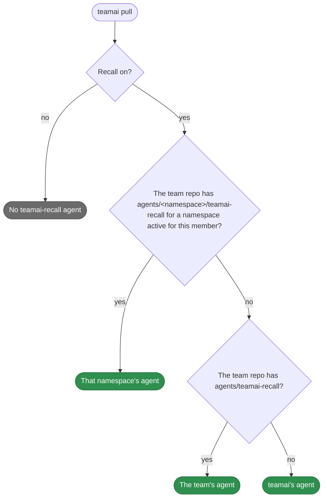

# Default agents

English | [中文](README.zh-CN.md)

The agents teamai ships. Each `<name>.md` here is one agent, and needs no folder. The [guide](https://github.com/Tencent/teamai-cli/blob/main/docs/guide/sharing.md#replace-the-recall-agent) covers them in full.

## teamai-recall

The [recall rule](../rules/teamai-recall/README.md) and the [TodoWrite hint](../hooks/teamai-todowrite-hint/README.md) send the agent to this subagent before a task. Its frontmatter and its instructions are in `teamai-recall.md`.

- **Input**: The task in plain words, such as `fix flaky integration tests`
- **Output**: A summary of the team knowledge that applies to the task
- **Runs**: `teamai recall --caller teamai-recall`

## Which agent a member gets



Pull writes the agent into each tool's agents directory, in that tool's format. Delete the team's file, and the next pull puts teamai's agent back.

## Replace it

```yaml
# agents/frontend/teamai-recall.yaml
name: teamai-recall
description: Search the team knowledge base for a frontend task and return doc_ids
tools: [Bash, Read, Grep, Glob]
instructions: |
  Run `teamai recall --caller teamai-recall "<task>"` and read the top three hits.
  Return at most ten lines: doc_ids, file paths, and the one rule that applies.
```

| Key | Can change | Keep |
|---|---|---|
| `name` | No | `teamai-recall`. The recall rule and the TodoWrite hint call the agent by that name |
| `description` | Yes. It tells the tool when to call the agent | |
| `tools` | Yes | `Bash`, which runs `teamai recall` |
| `model` | Yes, to a model id or a team alias | |
| `instructions`, or the Markdown body | Yes | `--caller teamai-recall` on each `teamai recall` call. It marks the run as this agent's, so recall adoption counts the docs the agent opens |

## Requires

| Needs | Without it |
|---|---|
| `teamai` on the agent's `PATH` | The agent cannot run `teamai recall` |

## Settings that change it

| Setting | Team | Member config | Environment | Effect |
|---|---|---|---|---|
| Recall | `sharing.recall.enabled` in `teamai.yaml` | `recallEnabled`, which `teamai recall enable` sets | `TEAMAI_RECALL_DISABLED=1` | When off, pull installs neither teamai's agent nor the team's |
| Namespaces | `agents/<namespace>/`, declared under `resources.agents` in `teamai.yaml` | The role, project and tags this scope selects | | Decide which namespaces are active, and so which agent a member gets |
| Model aliases | `models/aliases.yaml` and `models/<namespace>/aliases.yaml` | | | Map an alias in `model`, such as `strong`, to each tool's model |

The member config is `~/.teamai/projects/<slug>/config.yaml` in a workspace, then `~/.teamai/config.yaml`. The environment wins over the member config, and the member config wins over the team. See [member settings](https://github.com/Tencent/teamai-cli/blob/main/docs/guide/reference.md#member-settings) for the defaults.
