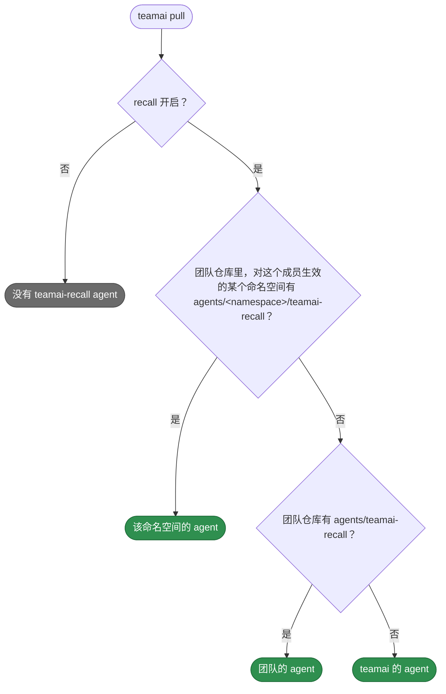

# 默认 agent

[English](README.md) | 中文

teamai 自带的 agent。这里每个 `<name>.md` 是一个 agent，不需要文件夹。[指南](https://github.com/Tencent/teamai-cli/blob/main/docs/guide/zh-CN/sharing.md#替换-recall-agent)有完整说明。

## teamai-recall

[recall rule](../rules/teamai-recall/README.zh-CN.md) 和 [TodoWrite 提示](../hooks/teamai-todowrite-hint/README.zh-CN.md)会让 agent 在任务开始前先调用这个 subagent。它的 frontmatter 和指令在 `teamai-recall.md` 里。

- **输入**: 用平常的话描述的任务，例如 `fix flaky integration tests`
- **输出**: 适用于这个任务的团队知识摘要
- **运行**: `teamai recall --caller teamai-recall`

## 成员拿到哪个 agent



pull 按每个工具的格式，把 agent 写入该工具的 agents 目录。删掉团队的文件，下一次 pull 就换回 teamai 的 agent。

## 替换它

```yaml
# agents/frontend/teamai-recall.yaml
name: teamai-recall
description: Search the team knowledge base for a frontend task and return doc_ids
tools: [Bash, Read, Grep, Glob]
instructions: |
  Run `teamai recall --caller teamai-recall "<task>"` and read the top three hits.
  Return at most ten lines: doc_ids, file paths, and the one rule that applies.
```

| 键 | 能否修改 | 保留 |
|---|---|---|
| `name` | 不能 | `teamai-recall`。recall rule 和 TodoWrite 提示按这个名字调用 agent |
| `description` | 能。它告诉工具何时调用这个 agent | |
| `tools` | 能 | `Bash`，用来运行 `teamai recall` |
| `model` | 能，改为模型 id 或团队别名 | |
| `instructions` 或 Markdown 正文 | 能 | 每次调用 `teamai recall` 都带上 `--caller teamai-recall`。它把这次运行标记为这个 agent 的，recall 采用统计才会计入 agent 打开的文档 |

## 依赖

| 需要 | 没有时 |
|---|---|
| agent 的 `PATH` 上有 `teamai` | agent 无法运行 `teamai recall` |

## 影响它的设置

| 设置 | 团队 | 成员配置 | 环境变量 | 作用 |
|---|---|---|---|---|
| Recall | `teamai.yaml` 里的 `sharing.recall.enabled` | `recallEnabled`，由 `teamai recall enable` 设置 | `TEAMAI_RECALL_DISABLED=1` | 关闭时，pull 既不安装 teamai 的 agent，也不安装团队的 |
| 命名空间 | `agents/<namespace>/`，在 `teamai.yaml` 的 `resources.agents` 下声明 | 这个 scope 选定的角色、项目和标签 | | 决定哪些命名空间生效，从而决定成员拿到哪个 agent |
| 模型别名 | `models/aliases.yaml` 和 `models/<namespace>/aliases.yaml` | | | 把 `model` 里的别名（例如 `strong`）映射到每个工具的模型 |

成员配置在工作区里是 `~/.teamai/projects/<slug>/config.yaml`，其次是 `~/.teamai/config.yaml`。环境变量优先于成员配置，成员配置优先于团队。默认值见[成员设置](https://github.com/Tencent/teamai-cli/blob/main/docs/guide/zh-CN/reference.md#成员设置)。
