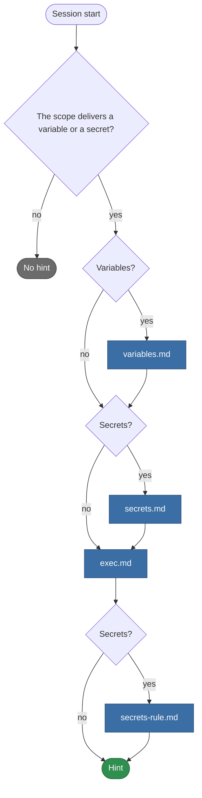

# teamai-env-hint

English | [中文](README.zh-CN.md)

- **Runs**: At session start
- **Input**: The team env variables and secrets this scope delivers
- **Output**: Their names and descriptions, and how to run the commands that need them
- **Files**: `HOOK.yaml` holds only `description`. Each `.md` file is one text of the hint

## What it prints



teamai joins the texts it prints with a space, in the order above.

## Replace it

Put only the files you change in `hooks/teamai-env-hint/` at the root of the team repo. Every other file, `HOOK.yaml` included, stays teamai's and keeps getting teamai's updates.

`hooks/teamai-env-hint/exec.md`:

```markdown
Run every `gh`, `kubectl` and `npm publish` through `teamai env exec -- <command>`. Never export a value yourself.
```

Push the folder. The next `teamai pull` checks your files with teamai's other files and delivers them together. The hint takes no parameters.

## Texts

| File | Variables |
|---|---|
| `variables.md` | `{{ variables }}`, such as `API_ENDPOINT (Team API endpoint), LOG_LEVEL` |
| `secrets.md` | `{{ secrets }}`, in the same form |
| `exec.md`, `secrets-rule.md` | None |

A name has its `description` in parentheses when the team gives one.

| `language` in `teamai.yaml` | The file teamai prints |
|---|---|
| Unset | `<text>.md` |
| `en` or `zh` | `<text>.en.md` or `<text>.zh.md` when the folder has it, else `<text>.md` |

## What pull refuses

| The replacement | What pull does |
|---|---|
| Misses a text, sets a `with:` key, or sets a `command` | Names the field and keeps teamai's folder |
| Uses a variable its text does not offer | The same |
| Sits in a namespace, such as `hooks/frontend/teamai-env-hint/` | The same. A replacement goes at the root of the team repo |

## Settings that change it

| Setting | Where | Effect |
|---|---|---|
| The variables and secrets | `env/env.yaml`, `env/secrets.yaml` and their copies in `env/<namespace>/` in the team repo | Decide what the hint names. A secret counts once `teamai env set` stored it on this machine |
| The namespaces | The role, project and tags in the member config | Decide which `env/<namespace>/` files this scope delivers |
| Language | `language` in `teamai.yaml` | Picks the text variant |

The member config is `~/.teamai/projects/<slug>/config.yaml` in a workspace, and `~/.teamai/config.yaml` in user scope.
