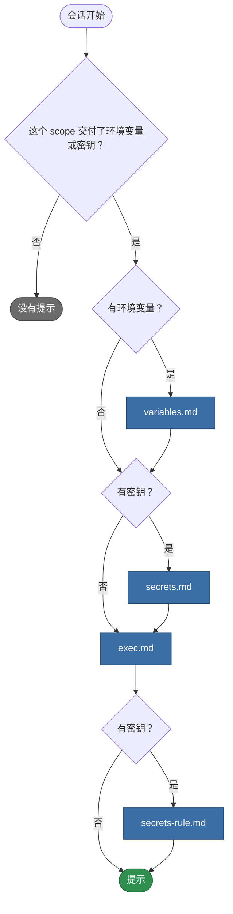

# teamai-env-hint

[English](README.md) | 中文

- **运行时机**: 会话开始时
- **输入**: 这个 scope 交付的团队环境变量和密钥
- **输出**: 它们的名字和描述，以及需要它们的命令该怎么运行
- **文件**: `HOOK.yaml` 里只有 `description`。每个 `.md` 文件是提示的一段文案

## 打印什么



teamai 按上面的顺序，用空格把要打印的文案连起来。

## 替换它

```bash
cp -r "$(npm root -g)/teamai-cli/hooks/teamai-env-hint" hooks/
```

`hooks/teamai-env-hint/exec.md`：

```markdown
Run every `gh`, `kubectl` and `npm publish` through `teamai env exec -- <command>`. Never export a value yourself.
```

推送这个文件夹。下一次 `teamai pull` 会检查并交付它。这条提示没有参数。

## 文案

| 文件 | 变量 |
|---|---|
| `variables.md` | `{{ variables }}`，例如 `API_ENDPOINT (Team API endpoint), LOG_LEVEL` |
| `secrets.md` | `{{ secrets }}`，形式相同 |
| `exec.md`、`secrets-rule.md` | 无 |

团队给了 `description` 时，名字后面的括号里是它。

| `teamai.yaml` 里的 `language` | teamai 打印的文件 |
|---|---|
| 未设置 | `<text>.md` |
| `en` 或 `zh` | 文件夹里有 `<text>.en.md` 或 `<text>.zh.md` 时打印它，否则打印 `<text>.md` |

## pull 拒绝什么

| 替换 | pull 怎么做 |
|---|---|
| 缺少某段文案、设置了 `with:` 键，或设置了 `command` | 指出是哪个字段，继续使用 teamai 的文件夹 |
| 使用了文案不提供的变量 | 同上 |
| 放在命名空间里，例如 `hooks/frontend/teamai-env-hint/` | 同上。替换要放在团队仓库根目录 |

## 影响它的设置

| 设置 | 位置 | 作用 |
|---|---|---|
| 环境变量和密钥 | 团队仓库里的 `env/env.yaml`、`env/secrets.yaml`，以及它们在 `env/<namespace>/` 里的副本 | 决定提示列出哪些名字。密钥要等 `teamai env set` 把它存到本机后才算数 |
| 命名空间 | 成员配置里的角色、项目和标签 | 决定这个 scope 交付哪些 `env/<namespace>/` 文件 |
| 语言 | `teamai.yaml` 里的 `language` | 选择文案版本 |

成员配置在工作区里是 `~/.teamai/projects/<slug>/config.yaml`，在 user scope 里是 `~/.teamai/config.yaml`。
