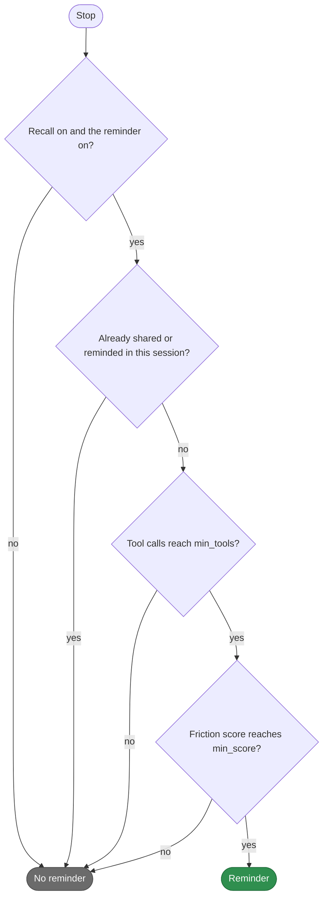
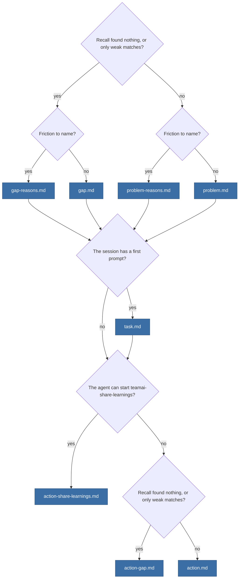

# teamai-friction-reminder

English | [中文](README.zh-CN.md)

- **Runs**: At Stop
- **Input**: The session's tool calls, interruptions, refusals, corrections, failing retries and recall hits
- **Output**: A reminder to share what the session taught
- **Files**: `HOOK.yaml` holds teamai's thresholds and weights. Each `.md` file is one text of the reminder

## When it reminds



The score adds the points that the [parameters](#parameters) give. For example, two interruptions and one refused call add `2 × weights.interrupt + weights.reject`.

## Which texts it prints

The reminder is a headline, the task line, and an action, with a blank line between each.



## Replace it

```bash
cp -r "$(npm root -g)/teamai-cli/hooks/teamai-friction-reminder" hooks/
```

```yaml
# hooks/teamai-friction-reminder/HOOK.yaml
description: Remind only after longer sessions
with:
  min_tools: 30
  weights: { reject: 30 }   # interrupt and correction keep teamai's values
```

Push the folder. The next `teamai pull` checks it and delivers it. A key you leave out of `with:` keeps teamai's value from its `HOOK.yaml`.

## Parameters

| Key | Range | What it sets |
|---|---|---|
| `min_tools` | 1-1000 | The tool calls a session needs before it can get the reminder |
| `min_score` | 1-1000 | The friction score a session needs |
| `weights.interrupt` | 0-100 | Points for each time the person stopped the agent |
| `weights.reject` | 0-100 | Points for each refused tool call |
| `weights.correction` | 0-100 | Points for each prompt that corrected the agent |
| `tool_error_tiers` | 1 to 5 tiers. `min` is 1-1000, in strictly descending order. `points` is 0-100 | Points for failing tool calls the agent retried. The first tier whose `min` the count reaches gives its points |
| `skill_bonus` | 0-100 | Points when the session used a skill |
| `diversity_bonus_max` | 0-100 | The most points for using many different tools |
| `knowledge_gap_bonus` | 0-100 | Points when recall found nothing |
| `low_quality_bonus` | 0-100 | Points when recall found only weak matches |
| `low_quality_threshold` | 0-100 | A match whose recall score is under this value is weak |

## Texts

| File | Variables |
|---|---|
| `problem.md`, `gap.md`, `action.md`, `action-gap.md` | None |
| `problem-reasons.md`, `gap-reasons.md` | `{{ reasons }}`, such as `you interrupted the AI twice`. It is always English |
| `task.md` | `{{ task }}`, the first prompt on one line, with secrets redacted and long prompts cut |
| `action-share-learnings.md` | `{{ command }}`, the command that describes `teamai-share-learnings` |

| `language` in `teamai.yaml` | The file teamai prints |
|---|---|
| Unset | `<text>.md` |
| `en` or `zh` | `<text>.en.md` or `<text>.zh.md` when the folder has it, else `<text>.md` |

## What pull refuses

| The replacement | What pull does |
|---|---|
| Misses a text, sets a value out of range, sets a key the table above does not list, or sets a `command` | Names the field and keeps teamai's folder |
| Uses a variable its text does not offer | The same |
| Sits in a namespace, such as `hooks/frontend/teamai-friction-reminder/` | The same. A replacement goes at the root of the team repo |

## Settings that change it

| Setting | Team `teamai.yaml` | Member config | Environment | Effect |
|---|---|---|---|---|
| The reminder | `sharing.contributeHint.enabled` | `contributeHintEnabled` | `TEAMAI_CONTRIBUTE_HINT_DISABLED=1` | When off, no session gets the reminder |
| Recall | `sharing.recall.enabled` | `recallEnabled` | `TEAMAI_RECALL_DISABLED=1` | When off, no session gets the reminder |
| Correction words | `sharing.intervention.correctionKeywords` | | | Adds words, beside teamai's, that make a prompt a correction |
| Language | `language` | | | Picks the text variant |

The member config is `~/.teamai/projects/<slug>/config.yaml` in a workspace, then `~/.teamai/config.yaml`. The environment wins over the member config, and the member config wins over the team. See [member settings](https://github.com/Tencent/teamai-cli/blob/main/docs/guide/reference.md#member-settings) for the defaults.
