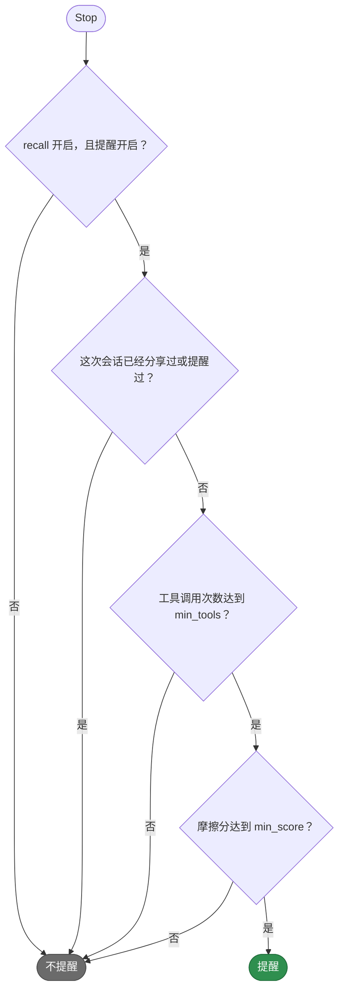
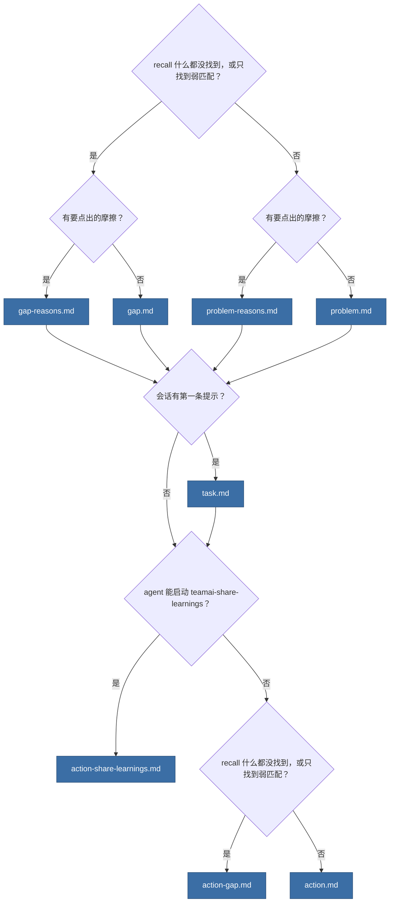

# teamai-friction-reminder

[English](README.md) | 中文

- **运行时机**: Stop 时
- **输入**: 会话的工具调用、打断、拒绝、纠正、失败后的重试和 recall 命中
- **输出**: 提醒分享这次会话学到的东西
- **文件**: `params.yaml` 保存 teamai 的阈值和权重。每个 `.md` 文件是提醒的一段文案

## 何时提醒



分数是[参数](#参数)给出的分相加。例如两次打断和一次被拒绝的调用，加 `2 × weights.interrupt + weights.reject`。

## 打印哪些文案

提醒由标题、任务行和行动组成，每两部分之间空一行。



## 替换它

在团队仓库根目录的 `hooks/teamai-friction-reminder/` 里只放你要改的文件。其他文件（包括 `params.yaml`）仍用 teamai 的，并继续获得 teamai 的更新。

```yaml
# hooks/teamai-friction-reminder/params.yaml
min_tools: 30
weights: { reject: 30 }   # interrupt and correction keep teamai's values
```

推送这个文件夹。下一次 `teamai pull` 会把你的文件和 teamai 的其他文件一起检查并交付。`params.yaml` 里没写的键，沿用 teamai 的 `params.yaml` 里的值。

## 参数

| 键 | 范围 | 设置什么 |
|---|---|---|
| `min_tools` | 1-1000 | 会话拿到提醒前需要的工具调用次数 |
| `min_score` | 1-1000 | 会话需要达到的摩擦分 |
| `weights.interrupt` | 0-100 | 用户每次打断 agent 加的分 |
| `weights.reject` | 0-100 | 每次被拒绝的工具调用加的分 |
| `weights.correction` | 0-100 | 每条纠正 agent 的提示加的分 |
| `tool_error_tiers` | 1 到 5 档。`min` 为 1-1000，严格递减。`points` 为 0-100 | agent 重试过的失败工具调用加的分。次数达到的第一档 `min` 给出该档的分 |
| `skill_bonus` | 0-100 | 会话用到 skill 时加的分 |
| `diversity_bonus_max` | 0-100 | 用到很多不同工具时最多加的分 |
| `knowledge_gap_bonus` | 0-100 | recall 什么都没找到时加的分 |
| `low_quality_bonus` | 0-100 | recall 只找到弱匹配时加的分 |
| `low_quality_threshold` | 0-100 | recall 分数低于这个值的匹配算作弱匹配 |

## 文案

| 文件 | 变量 |
|---|---|
| `problem.md`、`gap.md`、`action.md`、`action-gap.md` | 无 |
| `problem-reasons.md`、`gap-reasons.md` | `{{ reasons }}`，会话出现的各个信号的原因文本，用逗号连接，例如 `你打断了 AI 2 次，你拒绝了 1 次工具调用` |
| `reason-interrupt.md`、`reason-correction.md`、`reason-tool-error.md` | `{{ count }}`，例如 `2`；`{{ times }}`，`.zh.md` 文件中例如 `2 次`，英文文件中例如 `twice` |
| `reason-tool-reject.md` | `{{ count }}`、`{{ times }}`，以及 `{{ tool_calls }}`，`.zh.md` 文件中例如 `1 次工具调用`，英文文件中例如 `1 tool call` |
| `task.md` | `{{ task }}`，第一条提示压成一行，密钥已打码，过长的提示会截断 |
| `action-share-learnings.md` | `{{ command }}`，描述 `teamai-share-learnings` 的命令 |

| `teamai.yaml` 里的 `language` | teamai 打印的文件 |
|---|---|
| 未设置 | `<text>.md` |
| `en` 或 `zh` | 文件夹里有 `<text>.en.md` 或 `<text>.zh.md` 时打印它，否则打印 `<text>.md` |

## pull 拒绝什么

| 替换 | pull 怎么做 |
|---|---|
| 缺少某段文案、设置了超出范围的值、设置了上表没有列出的键、在 `HOOK.yaml` 里保留了 `with:`，或设置了 `command` | 指出是哪个字段，继续使用 teamai 的文件夹 |
| 使用了文案不提供的变量 | 同上 |
| 放在命名空间里，例如 `hooks/frontend/teamai-friction-reminder/` | 同上。替换要放在团队仓库根目录 |

## 影响它的设置

| 设置 | 团队 `teamai.yaml` | 成员配置 | 环境变量 | 作用 |
|---|---|---|---|---|
| 提醒 | `sharing.contributeHint.enabled` | `contributeHintEnabled` | `TEAMAI_CONTRIBUTE_HINT_DISABLED=1` | 关闭时，没有会话收到提醒 |
| Recall | `sharing.recall.enabled` | `recallEnabled` | `TEAMAI_RECALL_DISABLED=1` | 关闭时，没有会话收到提醒 |
| 纠正词 | `sharing.intervention.correctionKeywords` | | | 在 teamai 自带的词之外，再加一些让提示算作纠正的词 |
| 语言 | `language` | | | 选择文案版本 |

成员配置在工作区里是 `~/.teamai/projects/<slug>/config.yaml`，其次是 `~/.teamai/config.yaml`。环境变量优先于成员配置，成员配置优先于团队。默认值见[成员设置](https://github.com/Tencent/teamai-cli/blob/main/docs/guide/zh-CN/reference.md#成员设置)。
