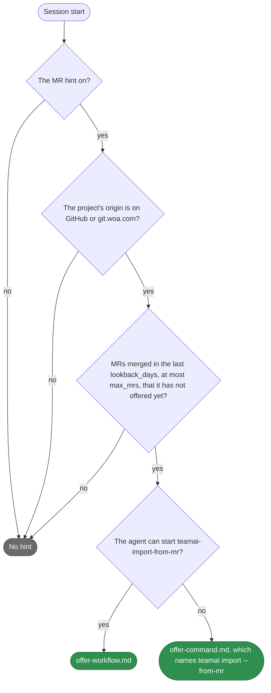

# teamai-mr-hint

English | [中文](README.zh-CN.md)

- **Runs**: At session start
- **Input**: The MRs merged in the project's repository in the last `lookback_days`, except the ones it already offered
- **Output**: An offer to turn them into learnings with [`teamai-import-from-mr`](../../workflows/teamai-import-from-mr/README.md)
- **Files**: `HOOK.yaml` holds teamai's parameters. Each `.md` file is one text of the offer

## When it offers



The agent cannot start the workflow in a session that teamai itself launched.

## Replace it

```bash
cp -r "$(npm root -g)/teamai-cli/hooks/teamai-mr-hint" hooks/
```

```yaml
# hooks/teamai-mr-hint/HOOK.yaml
description: Offer the last two weeks of MRs
with:
  lookback_days: 14   # max_mrs keeps teamai's value
```

Push the folder. The next `teamai pull` checks it and delivers it. A key you leave out of `with:` keeps teamai's value from its `HOOK.yaml`.

## Parameters

| Key | Range | What it sets |
|---|---|---|
| `lookback_days` | 1-90 | How many days back an MR may have merged |
| `max_mrs` | 1-100 | The most MRs listed, and the page size teamai asks the provider for |

## Texts

Both texts take `{{ count }}`, `{{ mr_lines }}` and `{{ command }}`. `{{ mr_lines }}` has one line per MR:

| File | One line of `{{ mr_lines }}` |
|---|---|
| `offer-command.en.md` | `- Fix retry backoff (merged: 2026-11-02)` |
| `offer-command.md` | `- Fix retry backoff（merged: 2026-11-02）` |
| `offer-workflow.en.md`, `offer-workflow.md` | The same, followed by the MR's URL |

| `language` in `teamai.yaml` | The file teamai prints |
|---|---|
| Unset | `<text>.md`, in Chinese and English |
| `en` | `<text>.en.md`, in English only |
| `zh` | `<text>.zh.md` when the folder has it, else `<text>.md` |

## What pull refuses

| The replacement | What pull does |
|---|---|
| Misses a text, sets a value out of range, sets a key the table above does not list, or sets a `command` | Names the field and keeps teamai's folder |
| Uses a variable its text does not offer | The same |
| Sits in a namespace, such as `hooks/frontend/teamai-mr-hint/` | The same. A replacement goes at the root of the team repo |

## Settings that change it

| Setting | Team `teamai.yaml` | Member config | Environment | Effect |
|---|---|---|---|---|
| The hint | `sharing.mrHint.enabled` | `mrHintEnabled` | `TEAMAI_MR_HINT_DISABLED=1` | When off, no session gets the hint |
| Language | `language` | | | Picks the text variant |
| GitHub token | | | `GITHUB_TOKEN` | When set, teamai sends it to GitHub, which then allows more requests |

The member config is `~/.teamai/projects/<slug>/config.yaml` in a workspace, then `~/.teamai/config.yaml`. The environment wins over the member config, and the member config wins over the team. See [member settings](https://github.com/Tencent/teamai-cli/blob/main/docs/guide/reference.md#member-settings) for the defaults.
