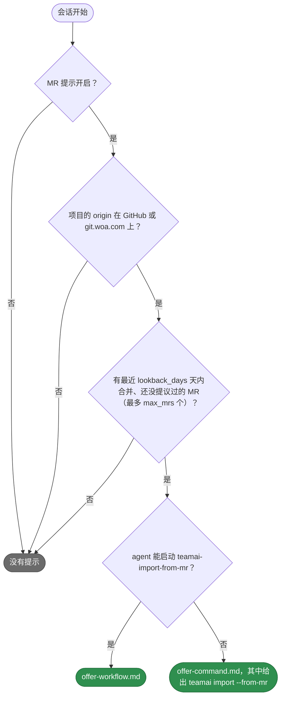

# teamai-mr-hint

[English](README.md) | 中文

- **运行时机**: 会话开始时，在 hook 返回之后。提议在会话的下一条提示词时显示；teamai 没有给工具装提示词 hook 时，在会话开始时显示
- **输入**: 项目仓库在最近 `lookback_days` 天内合并的 MR，已经提议过的除外
- **输出**: 一条提议：用 [`teamai-import-from-mr`](../../workflows/teamai-import-from-mr/README.zh-CN.md) 把它们整理成 learning
- **文件**: `HOOK.yaml` 保存 teamai 的参数。每个 `.md` 文件是提议的一段文案

## 何时提议



在 teamai 自己启动的会话里，agent 不能启动这个工作流。

## 替换它

```bash
cp -r "$(npm root -g)/teamai-cli/hooks/teamai-mr-hint" hooks/
```

```yaml
# hooks/teamai-mr-hint/HOOK.yaml
description: Offer the last two weeks of MRs
with:
  lookback_days: 14   # max_mrs keeps teamai's value
```

推送这个文件夹。下一次 `teamai pull` 会检查并交付它。`with:` 里没写的键，沿用 teamai 的 `HOOK.yaml` 里的值。

## 参数

| 键 | 范围 | 设置什么 |
|---|---|---|
| `lookback_days` | 1-90 | MR 最多可以是多少天前合并的 |
| `max_mrs` | 1-100 | 最多列出多少个 MR，也是 teamai 向代码托管平台请求的每页数量 |

## 文案

两段文案都接收 `{{ count }}`、`{{ mr_lines }}` 和 `{{ command }}`。`{{ mr_lines }}` 每个 MR 一行：

| 文件 | `{{ mr_lines }}` 的一行 |
|---|---|
| `offer-command.en.md` | `- Fix retry backoff (merged: 2026-11-02)` |
| `offer-command.md` | `- Fix retry backoff（merged: 2026-11-02）` |
| `offer-workflow.en.md`、`offer-workflow.md` | 同上，后面跟着 MR 的 URL |

| `teamai.yaml` 里的 `language` | teamai 打印的文件 |
|---|---|
| 未设置 | `<text>.md`，中英双语 |
| `en` | `<text>.en.md`，只有英文 |
| `zh` | 文件夹里有 `<text>.zh.md` 时打印它，否则打印 `<text>.md` |

## pull 拒绝什么

| 替换 | pull 怎么做 |
|---|---|
| 缺少某段文案、设置了超出范围的值、设置了上表没有列出的键，或设置了 `command` | 指出是哪个字段，继续使用 teamai 的文件夹 |
| 使用了文案不提供的变量 | 同上 |
| 放在命名空间里，例如 `hooks/frontend/teamai-mr-hint/` | 同上。替换要放在团队仓库根目录 |

## 影响它的设置

| 设置 | 团队 `teamai.yaml` | 成员配置 | 环境变量 | 作用 |
|---|---|---|---|---|
| 提示 | `sharing.mrHint.enabled` | `mrHintEnabled` | `TEAMAI_MR_HINT_DISABLED=1` | 关闭时，没有会话收到提示 |
| 语言 | `language` | | | 选择文案版本 |
| GitHub token | | | `GITHUB_TOKEN` | 设置后，teamai 把它发给 GitHub，GitHub 就允许更多请求 |

成员配置在工作区里是 `~/.teamai/projects/<slug>/config.yaml`，其次是 `~/.teamai/config.yaml`。环境变量优先于成员配置，成员配置优先于团队。默认值见[成员设置](https://github.com/Tencent/teamai-cli/blob/main/docs/guide/zh-CN/reference.md#成员设置)。
