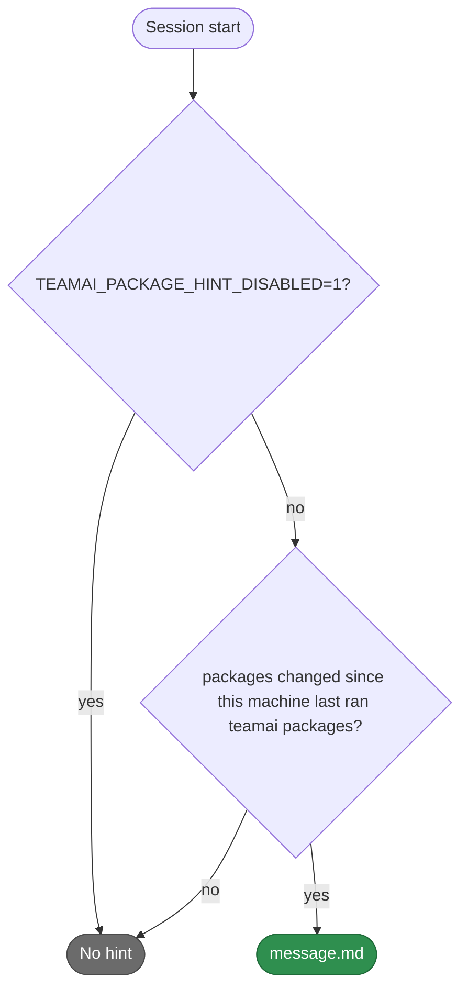

# teamai-package-hint

English | [中文](README.zh-CN.md)

- **Runs**: At session start
- **Input**: The `packages` section of the team's `teamai.yaml`, and what this machine last applied
- **Output**: When the section changed, a request to review it and run `teamai packages`
- **Files**: `HOOK.yaml` holds only `description`. `message.md` is the text of the hint

## When it prints



## Replace it

Put only the files you change in `hooks/teamai-package-hint/` at the root of the team repo. Every other file, `HOOK.yaml` included, stays teamai's and keeps getting teamai's updates.

`hooks/teamai-package-hint/message.md`:

```markdown
The team's packages changed ({{ summary }}). List what `teamai packages` installs, and ask the member before you run it.
```

Push the folder. The next `teamai pull` checks your files with teamai's other files and delivers them together. The hint takes no parameters.

## Texts

| File | Variables |
|---|---|
| `message.md` | `{{ summary }}`, such as `2 npm packages and 1 Claude plugin`. It is always English |

| `language` in `teamai.yaml` | The file teamai prints |
|---|---|
| Unset | `message.md` |
| `en` or `zh` | `message.en.md` or `message.zh.md` when the folder has it, else `message.md` |

## What pull refuses

| The replacement | What pull does |
|---|---|
| Misses `message.md`, sets a `with:` key, or sets a `command` | Names the field and keeps teamai's folder |
| Uses a variable other than `summary` | The same |
| Sits in a namespace, such as `hooks/frontend/teamai-package-hint/` | The same. A replacement goes at the root of the team repo |

## Settings that change it

| Setting | Team `teamai.yaml` | Environment | Effect |
|---|---|---|---|
| Packages | `packages` | | A change since this machine last ran `teamai packages` shows the hint |
| The hint | | `TEAMAI_PACKAGE_HINT_DISABLED=1` | Turns the hint off on this machine |
| Language | `language` | | Picks the text variant |

No member config key changes it.
