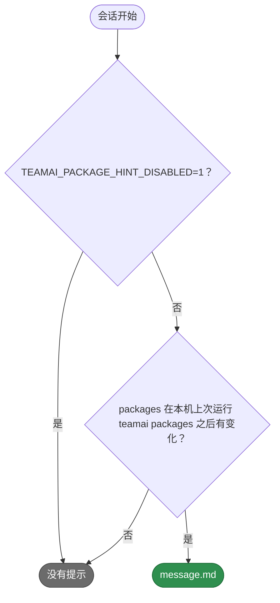

# teamai-package-hint

[English](README.md) | 中文

- **运行时机**: 会话开始时
- **输入**: 团队 `teamai.yaml` 的 `packages` 部分，以及本机上次应用的内容
- **输出**: 这部分有变化时，请求检查它并运行 `teamai packages`
- **文件**: `HOOK.yaml` 里只有 `description`。`message.md` 是提示的文案

## 何时打印



## 替换它

在团队仓库根目录的 `hooks/teamai-package-hint/` 里只放你要改的文件。其他文件（包括 `HOOK.yaml`）仍用 teamai 的，并继续获得 teamai 的更新。

`hooks/teamai-package-hint/message.md`：

```markdown
The team's packages changed ({{ summary }}). List what `teamai packages` installs, and ask the member before you run it.
```

推送这个文件夹。下一次 `teamai pull` 会把你的文件和 teamai 的其他文件一起检查并交付。这条提示没有参数。

## 文案

| 文件 | 变量 |
|---|---|
| `message.md` | `{{ summary }}`，例如 `2 npm packages and 1 Claude plugin`。它总是英文 |

| `teamai.yaml` 里的 `language` | teamai 打印的文件 |
|---|---|
| 未设置 | `message.md` |
| `en` 或 `zh` | 文件夹里有 `message.en.md` 或 `message.zh.md` 时打印它，否则打印 `message.md` |

## pull 拒绝什么

| 替换 | pull 怎么做 |
|---|---|
| 缺少 `message.md`、设置了 `with:` 键，或设置了 `command` | 指出是哪个字段，继续使用 teamai 的文件夹 |
| 使用了 `summary` 以外的变量 | 同上 |
| 放在命名空间里，例如 `hooks/frontend/teamai-package-hint/` | 同上。替换要放在团队仓库根目录 |

## 影响它的设置

| 设置 | 团队 `teamai.yaml` | 环境变量 | 作用 |
|---|---|---|---|
| 包 | `packages` | | 本机上次运行 `teamai packages` 之后有变化，就显示提示 |
| 提示 | | `TEAMAI_PACKAGE_HINT_DISABLED=1` | 在本机关闭提示 |
| 语言 | `language` | | 选择文案版本 |

没有成员配置键会改变它。
