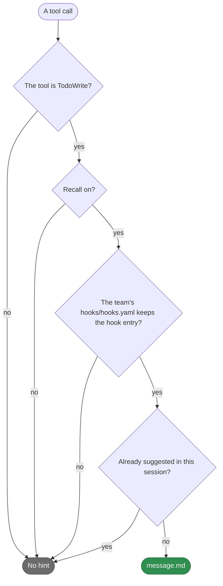

# teamai-todowrite-hint

English | [中文](README.zh-CN.md)

- **Runs**: After a TodoWrite call
- **Input**: None
- **Output**: A suggestion to search the team knowledge base once with the [`teamai-recall`](../../agents/README.md) subagent
- **Files**: `HOOK.yaml` holds only `description`. `message.md` is the text of the hint

## When it suggests



## Replace it

```bash
cp -r "$(npm root -g)/teamai-cli/hooks/teamai-todowrite-hint" hooks/
```

`hooks/teamai-todowrite-hint/message.md`:

```markdown
Call the `teamai-recall` subagent once before the first edit.
```

The copy also holds a language variant of `message.md`. Edit the variant too, or delete it, so every `language` prints your text. Push the folder. The next `teamai pull` checks it and delivers it. The hint takes no parameters.

## Texts

| File | Variables |
|---|---|
| `message.md` | None |

| `language` in `teamai.yaml` | The file teamai prints |
|---|---|
| Unset | `message.md` |
| `en` or `zh` | `message.en.md` or `message.zh.md` when the folder has it, else `message.md` |

## What pull refuses

| The replacement | What pull does |
|---|---|
| Misses `message.md`, sets a `with:` key, or sets a `command` | Names the field and keeps teamai's folder |
| Uses a variable | The same. The text offers none |
| Sits in a namespace, such as `hooks/frontend/teamai-todowrite-hint/` | The same. A replacement goes at the root of the team repo |

## Settings that change it

| Setting | Team | Member config | Environment | Effect |
|---|---|---|---|---|
| Recall | `sharing.recall.enabled` in `teamai.yaml` | `recallEnabled` | `TEAMAI_RECALL_DISABLED=1` | When off, no session gets the hint |
| The hook entry | `builtin.disabled: [Hook dispatch post-tool-use TodoWrite]` in `hooks/hooks.yaml` | | | When listed, no session gets the hint |
| Language | `language` in `teamai.yaml` | | | Picks the text variant |

The member config is `~/.teamai/projects/<slug>/config.yaml` in a workspace, then `~/.teamai/config.yaml`. The environment wins over the member config, and the member config wins over the team. See [member settings](https://github.com/Tencent/teamai-cli/blob/main/docs/guide/reference.md#member-settings) for the defaults.
