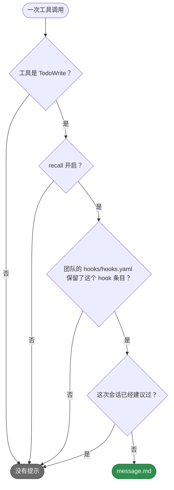

# teamai-todowrite-hint

[English](README.md) | 中文

- **运行时机**: TodoWrite 调用之后
- **输入**: 无
- **输出**: 建议用 [`teamai-recall`](../../agents/README.zh-CN.md) subagent 检索一次团队知识库
- **文件**: `HOOK.yaml` 里只有 `description`。`message.md` 是提示的文案

## 何时建议



## 替换它

在团队仓库根目录的 `hooks/teamai-todowrite-hint/` 里只放你要改的文件。其他文件（包括 `HOOK.yaml`）仍用 teamai 的，并继续获得 teamai 的更新。

`hooks/teamai-todowrite-hint/message.md`：

```markdown
Call the `teamai-recall` subagent once before the first edit.
```

你的 `message.md` 会替换这段文案的所有语言版本，所以每种 `language` 都会打印它。推送这个文件夹。下一次 `teamai pull` 会把你的文件和 teamai 的其他文件一起检查并交付。这条提示没有参数。

## 文案

| 文件 | 变量 |
|---|---|
| `message.md` | 无 |

| `teamai.yaml` 里的 `language` | teamai 打印的文件 |
|---|---|
| 未设置 | `message.md` |
| `en` 或 `zh` | 文件夹里有 `message.en.md` 或 `message.zh.md` 时打印它，否则打印 `message.md` |

## pull 拒绝什么

| 替换 | pull 怎么做 |
|---|---|
| 缺少 `message.md`、设置了 `with:` 键，或设置了 `command` | 指出是哪个字段，继续使用 teamai 的文件夹 |
| 使用了变量 | 同上。这段文案不提供变量 |
| 放在命名空间里，例如 `hooks/frontend/teamai-todowrite-hint/` | 同上。替换要放在团队仓库根目录 |

## 影响它的设置

| 设置 | 团队 | 成员配置 | 环境变量 | 作用 |
|---|---|---|---|---|
| Recall | `teamai.yaml` 里的 `sharing.recall.enabled` | `recallEnabled` | `TEAMAI_RECALL_DISABLED=1` | 关闭时，没有会话收到提示 |
| hook 条目 | `hooks/hooks.yaml` 里的 `builtin.disabled: [Hook dispatch post-tool-use TodoWrite]` | | | 列出它时，没有会话收到提示 |
| 语言 | `teamai.yaml` 里的 `language` | | | 选择文案版本 |

成员配置在工作区里是 `~/.teamai/projects/<slug>/config.yaml`，其次是 `~/.teamai/config.yaml`。环境变量优先于成员配置，成员配置优先于团队。默认值见[成员设置](https://github.com/Tencent/teamai-cli/blob/main/docs/guide/zh-CN/reference.md#成员设置)。
