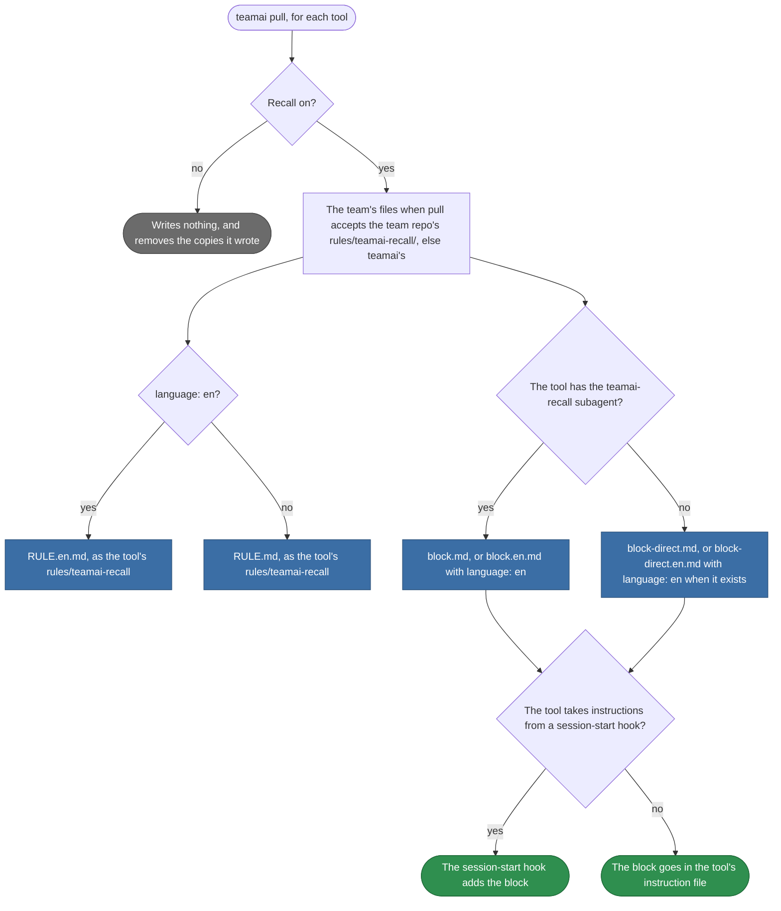

# teamai-recall

English | [中文](README.zh-CN.md)

The rule and the instruction blocks that tell an AI tool to search the team knowledge base before a task.

## Where pull writes each file



| File | Pull writes it |
|---|---|
| `RULE*.md` | To each tool's rules directory, as `teamai-recall<ext>` |
| `block*.md` | Into the instruction file, between the block markers and a `DO NOT EDIT` line |
| `README*.md` | Never |

Pull turns CRLF into LF and drops one trailing newline. The files hold no template variables.

## Replace it

Put only the files you change in `rules/teamai-recall/` at the root of the team repo. Every other file stays teamai's and keeps getting teamai's updates:

```bash
mkdir -p rules/teamai-recall
cp "$(npm root -g)/teamai-cli/rules/teamai-recall/RULE.md" rules/teamai-recall/
```

Then add your own text to it, such as a skip condition:

```markdown
## Skip for generated code

A change under `gen/` needs no team knowledge.
```

Your `RULE.md` replaces every language of the rule: with `language: en`, members read it instead of teamai's `RULE.en.md`. Copy `RULE.en.md` too, and change it the same way, to keep an English rule of your own.

Push the folder. The next `teamai pull` gives every member the team's files over teamai's. `teamai push` never publishes the rule.

## What a replacement keeps

| File | Must | Why |
|---|---|---|
| `RULE.md`, `block.md`, `block-direct.md` | Exist when the folder has a language of it | A language you write replaces teamai's base file too, and a missing language file falls back to the team's base file, never to teamai's |
| Every `RULE*.md` | Contain `Nothing was searched:` and `Recall skips the older index` | Recall prints those lines, and the rule tells the agent what to do with them |
| Every `block-direct*.md` | Contain `Nothing was searched:` | The same |
| Every file | Name no `${TEAMAI_RULE_DIR}` | Pull delivers only the files above, as text. Put an example in the file itself |

Pull checks the folder your files and teamai's make together. When it breaks one of these, pull names the file and keeps teamai's folder. A file teamai's folder does not have replaces nothing: pull warns, names it, and leaves it out, and `teamai review --branch` fails it.

## Settings that change it

| Setting | Team `teamai.yaml` | Member config | Environment | Effect |
|---|---|---|---|---|
| Recall | `sharing.recall.enabled` | `recallEnabled`, which `teamai recall enable` sets | `TEAMAI_RECALL_DISABLED=1` | When off, pull writes neither the rule nor the blocks |
| Language | `language` | | | `en` picks the `.en.md` files |

The member config is `~/.teamai/projects/<slug>/config.yaml` in a workspace, then `~/.teamai/config.yaml`. The environment wins over the member config, and the member config wins over the team. See [member settings](https://github.com/Tencent/teamai-cli/blob/main/docs/guide/reference.md#member-settings) for the defaults.
