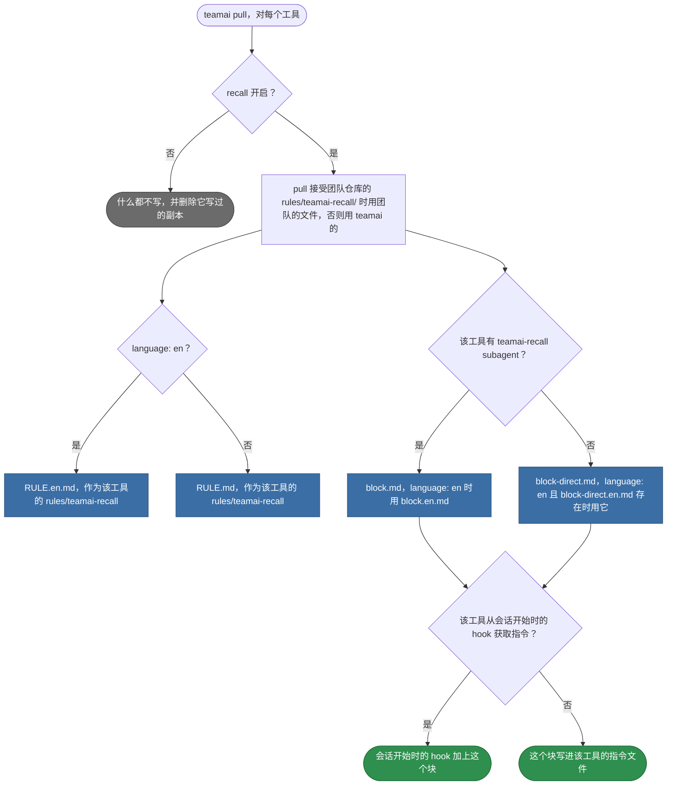

# teamai-recall

[English](README.md) | 中文

让 AI 工具在任务开始前检索团队知识库的 rule 和指令块。

## pull 把每个文件写到哪里



| 文件 | pull 把它写到 |
|---|---|
| `RULE*.md` | 每个工具的 rules 目录，文件名为 `teamai-recall<ext>` |
| `block*.md` | 指令文件里，放在块标记和一行 `DO NOT EDIT` 之间 |
| `README*.md` | 从不写入 |

pull 会把 CRLF 换成 LF，并去掉末尾的一个换行。这些文件里没有模板变量。

## 替换它

```bash
cp -r "$(npm root -g)/teamai-cli/rules/teamai-recall" rules/
```

然后在每个 `RULE*.md` 里加上你自己的文字，例如一个跳过条件：

```markdown
## Skip for generated code

A change under `gen/` needs no team knowledge.
```

推送这个文件夹。下一次 `teamai pull` 会让每个成员拿到团队的文件，而不是 teamai 的。`teamai push` 从不发布这条 rule。

## 替换要保留什么

| 文件 | 必须 | 原因 |
|---|---|---|
| `RULE.md`、`block.md`、`block-direct.md` | 存在 | 缺少某个语言文件时，回退到团队自己的基础文件，不会回退到 teamai 的 |
| 每个 `RULE*.md` | 包含 `Nothing was searched:` 和 `Recall skips the older index` | recall 会打印这些行，rule 告诉 agent 遇到它们时该怎么做 |
| 每个 `block-direct*.md` | 包含 `Nothing was searched:` | 同上 |
| 每个文件 | 不写 `${TEAMAI_RULE_DIR}` | pull 只以文本形式交付上面这些文件。示例请直接写进文件里 |

替换违反其中任何一条时，pull 会指出是哪个文件，并继续使用 teamai 的文件夹。

## 影响它的设置

| 设置 | 团队 `teamai.yaml` | 成员配置 | 环境变量 | 作用 |
|---|---|---|---|---|
| Recall | `sharing.recall.enabled` | `recallEnabled`，由 `teamai recall enable` 设置 | `TEAMAI_RECALL_DISABLED=1` | 关闭时，pull 既不写 rule，也不写指令块 |
| 语言 | `language` | | | `en` 选用 `.en.md` 文件 |

成员配置在工作区里是 `~/.teamai/projects/<slug>/config.yaml`，其次是 `~/.teamai/config.yaml`。环境变量优先于成员配置，成员配置优先于团队。默认值见[成员设置](https://github.com/Tencent/teamai-cli/blob/main/docs/guide/zh-CN/reference.md#成员设置)。
