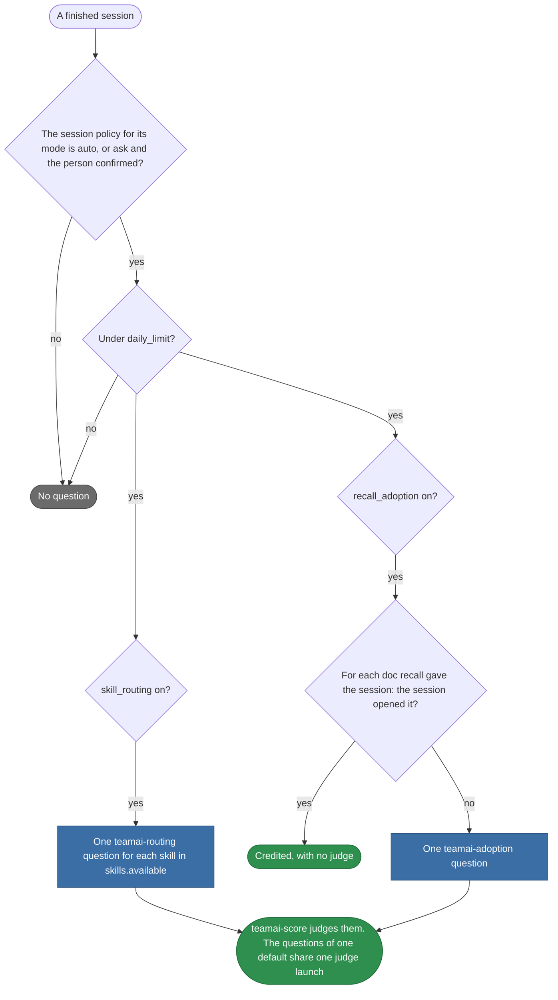
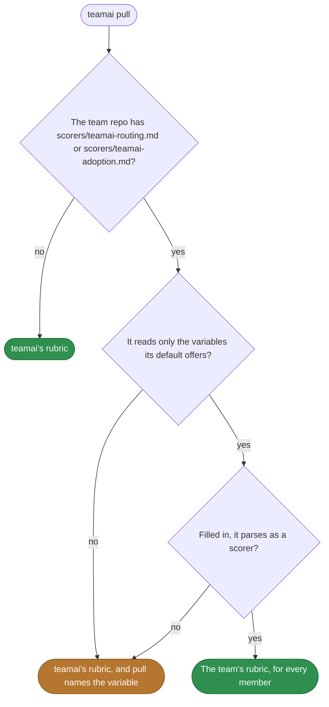

# Default scorers

English | [中文](README.zh-CN.md)

The rubrics of the questions teamai generates for each item of a judged session. Each `<name>.md` here is a scorer template, and teamai fills in its variables for each item. Its labels and its prompt are in the file. The [guide](https://github.com/Tencent/teamai-cli/blob/main/docs/guide/scorers.md#default-scorers) covers them in full.

| Default | Asks | Question name | Variables |
|---|---|---|---|
| `teamai-routing.md` | Whether each team skill loaded where the session needed it, and only there | `teamai:routing:<skill>`, or `teamai:routing:<namespace>:<skill>` | `skill.name` |
| `teamai-adoption.md` | Whether the session used a doc that recall gave it but that it never opened | `teamai:adoption:<hash>` | `doc.id`, `doc.path`, `doc.file` |

## Which questions a session gets



A session's mode is attended, or unattended in CI, on a cloud VM or with `TEAMAI_MODE=unattended`. On demand, `teamai score --session <id> --scorer teamai:routing:<skill>` asks one question whatever `skill_routing` says.

## Which rubric runs



## Replace one

```bash
cp "$(npm root -g)/teamai-cli/scorers/teamai-adoption.md" scorers/
```

Then edit the copy, such as adding a judge model to its frontmatter:

```yaml
model: fast   # a team alias from models/aliases.yaml
```

Push the file. The next `teamai pull` checks it and gives every member the team's rubric.

| Part of the file | Can change | Keep |
|---|---|---|
| `labels` | Yes. The values, the scores and the descriptions | Each `{{ … }}` inside a double-quoted string. The values teamai fills in hold quotes, colons and newlines |
| `passingScore` | Yes | |
| `model` | Yes, to a model name or a team alias | |
| The prompt after the frontmatter | Yes | Only the variables of the table above |

A changed rubric gives each question a new rubric hash, so the dashboard counts its labels apart from the old ones. The file is no scorer of its own: no step lists it, and `teamai score --scorer teamai-routing` finds nothing.

## Requires

| Needs | Without it |
|---|---|
| A judge, which is a tool and a model that the scorer's `model` resolves to | The judge step waits for a driver that can judge, and `teamai doctor` warns about the scorer |
| Recall on, for `teamai-adoption` | No session has recalled docs, so no adoption question |
| Team skills delivered to the session, for `teamai-routing` | No routing question |

## Settings that change them

| Setting | Team `scorers/scoring.yaml` | Member config | Environment | Effect |
|---|---|---|---|---|
| Session judging | `sessions: { attended, unattended }`, each `off`, `ask` or `auto` | `scoring.sessions` | `TEAMAI_MODE` and `CI` pick the mode | Decides which finished sessions get questions |
| Routing questions | `skill_routing` | `scoring.skill_routing` | | Turns the `teamai-routing` questions on or off |
| Adoption questions | `recall_adoption` | `scoring.recall_adoption` | | Turns the `teamai-adoption` questions on or off |
| Daily limit | `daily_limit` | `scoring.daily_limit` | | Caps how many sessions each workspace judges a day |
| Model alias | `models/aliases.yaml` | | | Maps an alias in `model`, such as `fast`, to each judge tool's model |
| Recall | `sharing.recall.enabled` in `teamai.yaml` | `recallEnabled` | `TEAMAI_RECALL_DISABLED=1` | When off, no session has recalled docs to ask about |

`scorers/<namespace>/scoring.yaml` overrides the root file for the members of an active namespace. When two active namespaces disagree on `sessions` or `daily_limit`, the stricter value wins.

| Member config | What it can do |
|---|---|
| `~/.teamai/projects/<slug>/config.yaml` | Turn any key on or off, or change it, for that workspace |
| `~/.teamai/config.yaml`, for every workspace on the machine | Only make judging stricter: turn a mode or a question off, or lower `daily_limit`. A machine never starts judging |

See [finished sessions](https://github.com/Tencent/teamai-cli/blob/main/docs/guide/scorers.md#finished-sessions) for the defaults, and [member settings](https://github.com/Tencent/teamai-cli/blob/main/docs/guide/reference.md#member-settings).
