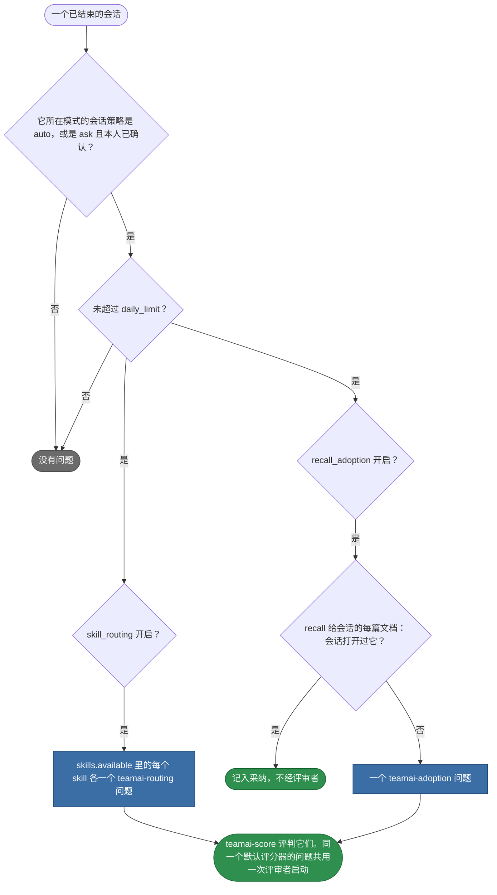
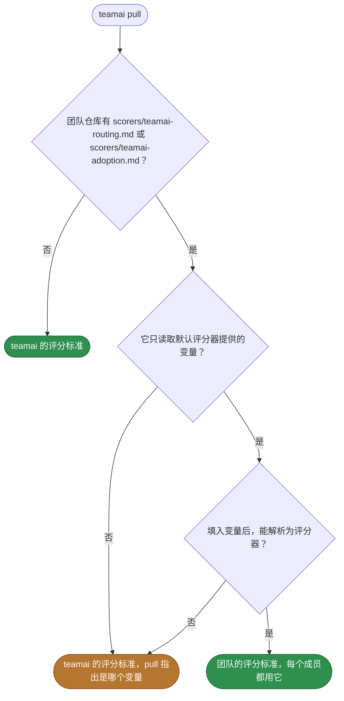

# 默认评分器

[English](README.md) | 中文

teamai 为被评判会话的每个条目生成问题，这里是这些问题的评分标准。这里每个 `<name>.md` 是一个评分器模板，teamai 为每个条目填入它的变量。它的标签和提示词在文件里。[指南](https://github.com/Tencent/teamai-cli/blob/main/docs/guide/zh-CN/scorers.md#默认评分器)有完整说明。

| 默认评分器 | 询问 | 问题名 | 变量 |
|---|---|---|---|
| `teamai-routing.md` | 每个团队 skill 是否在会话需要的地方加载，并且只在那里加载 | `teamai:routing:<skill>` 或 `teamai:routing:<namespace>:<skill>` | `skill.name` |
| `teamai-adoption.md` | 会话是否用上了 recall 给出、但它从未打开的文档 | `teamai:adoption:<hash>` | `doc.id`、`doc.path`、`doc.file` |

## 会话会收到哪些问题



会话的模式是有人值守，或无人值守：在 CI 中、在云虚拟机上，或设置了 `TEAMAI_MODE=unattended`。按需评分时，不管 `skill_routing` 怎么设，`teamai score --session <id> --scorer teamai:routing:<skill>` 都会提出一个问题。

## 运行哪份评分标准



## 替换其中一个

```bash
cp "$(npm root -g)/teamai-cli/scorers/teamai-adoption.md" scorers/
```

然后编辑副本，例如在 frontmatter 里加上评审模型：

```yaml
model: fast   # a team alias from models/aliases.yaml
```

推送这个文件。下一次 `teamai pull` 会检查它，并让每个成员都用团队的评分标准。

| 文件的部分 | 能否修改 | 保留 |
|---|---|---|
| `labels` | 能。值、分数和描述都能改 | 每个 `{{ … }}` 都放在双引号字符串里。teamai 填入的值含有引号、冒号和换行 |
| `passingScore` | 能 | |
| `model` | 能，改为模型名或团队别名 | |
| frontmatter 之后的提示词 | 能 | 只用上表列出的变量 |

评分标准一改，每个问题就有新的评分标准哈希，所以面板把它的标签和旧标签分开计数。这个文件本身不是评分器：没有步骤列出它，`teamai score --scorer teamai-routing` 也找不到它。

## 依赖

| 需要 | 没有时 |
|---|---|
| 评审者，即评分器的 `model` 解析出的工具和模型 | 评判步骤等待一个能评判的驱动，`teamai doctor` 会对这个评分器发出警告 |
| `teamai-adoption` 需要 recall 开启 | 没有会话有召回的文档，所以没有采纳问题 |
| `teamai-routing` 需要团队 skill 已交付到会话 | 没有路由问题 |

## 影响它们的设置

| 设置 | 团队 `scorers/scoring.yaml` | 成员配置 | 环境变量 | 作用 |
|---|---|---|---|---|
| 会话评判 | `sessions: { attended, unattended }`，每个取 `off`、`ask` 或 `auto` | `scoring.sessions` | `TEAMAI_MODE` 和 `CI` 决定模式 | 决定哪些已结束的会话收到问题 |
| 路由问题 | `skill_routing` | `scoring.skill_routing` | | 开启或关闭 `teamai-routing` 问题 |
| 采纳问题 | `recall_adoption` | `scoring.recall_adoption` | | 开启或关闭 `teamai-adoption` 问题 |
| 每日上限 | `daily_limit` | `scoring.daily_limit` | | 限制每个工作区每天评判多少个会话 |
| 模型别名 | `models/aliases.yaml` | | | 把 `model` 里的别名（例如 `fast`）映射到每个评审工具的模型 |
| Recall | `teamai.yaml` 里的 `sharing.recall.enabled` | `recallEnabled` | `TEAMAI_RECALL_DISABLED=1` | 关闭时，没有会话有召回的文档可以提问 |

`scorers/<namespace>/scoring.yaml` 为生效命名空间的成员覆盖根目录的文件。两个生效命名空间在 `sessions` 或 `daily_limit` 上不一致时，更严格的值生效。

| 成员配置 | 它能做什么 |
|---|---|
| `~/.teamai/projects/<slug>/config.yaml` | 为那个工作区开启、关闭或修改任何键 |
| `~/.teamai/config.yaml`，作用于本机所有工作区 | 只能让评判更严格：关闭一种模式或一类问题，或降低 `daily_limit`。本机永远不会开启评判 |

默认值见[已结束的会话](https://github.com/Tencent/teamai-cli/blob/main/docs/guide/zh-CN/scorers.md#已结束的会话)，另见[成员设置](https://github.com/Tencent/teamai-cli/blob/main/docs/guide/zh-CN/reference.md#成员设置)。
