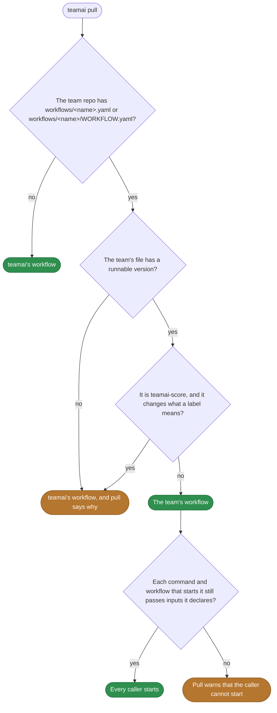
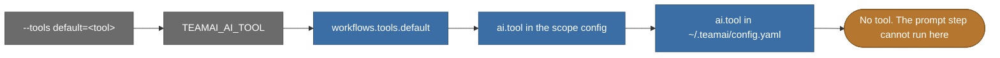

# Default workflows

English | [中文](README.zh-CN.md)

The workflows teamai ships. Each `<name>.yaml` here is one workflow. A workflow that keeps its prompts in files has a folder, `<name>/WORKFLOW.yaml`, with its own README. The [guide](https://github.com/Tencent/teamai-cli/blob/main/docs/guide/workflow.md#default-workflows) says what each workflow does.

## Read a workflow's interface

The file is the interface. Its `inputs:` and `outputs:` are what a command, or another workflow, passes and reads. To see the inputs as teamai checks them, with the version that runs here:

```bash
teamai workflow start teamai-share-learnings --describe
```

| Key in the file | What it tells you |
|---|---|
| `inputs:`, `outputs:` | What a caller passes and reads. A replacement keeps them |
| `invoke:` | Whether an agent session can start the workflow. See the table below |
| A step with `workflow: <name>` | The workflow runs that other workflow |
| A step with `prompt:`, `answer:` or `answer_file:` | The workflow needs an AI tool |
| A step with `scorers:`, or `workflow: teamai-score` | The workflow needs a judge |
| A step with `workspace: { team: ... }` and `deliver: pr` | The workflow pushes a branch of the team repo and opens a pull request |
| A step with `requires: { isolation: sandbox }` | The step runs only on a machine that declares a sandbox |

| `invoke` | What `teamai pull` does |
|---|---|
| `allow` | Writes a skill that lets an agent session find the workflow. On Claude Code and CodeBuddy, the skill also pre-approves the `workflow start` command |
| `ask` | Writes the skill, with no pre-approval |
| `deny` | Writes no skill. Only a command or another workflow starts it |

## Replace one

```bash
cp "$(npm root -g)/teamai-cli/workflows/teamai-share-learnings-from-sessions.yaml" workflows/
```

```yaml
# workflows/teamai-share-learnings-from-sessions.yaml in the team repo
invoke: allow   # let an agent session start it without asking
```

Push the file. The next `teamai pull` uses the team's file instead of teamai's. A replacement can change everything in the file: `description`, `invoke`, `alias`, the prompts, the steps, their order and each `timeout`.

### Which version runs



### What a replacement keeps

| Workflow | Keep | Otherwise, pull |
|---|---|---|
| Every workflow | The names and types of its `inputs:` and `outputs:` | Uses the team's workflow, and warns that the caller cannot start |
| `teamai-score` | What each label means. See [what it may change](https://github.com/Tencent/teamai-cli/blob/main/docs/guide/scorers.md#replace-it-for-your-team) | Uses teamai's, and reports `score_override_*` |
| `teamai-score` | Its name. An `alias: teamai-score` on another file does not replace it | Uses teamai's, and reports `default_override_alias` |

## Which AI tool answers a prompt

When a step names no `tool:` and no `agent:`, the first of these that names a tool wins:



`teamai-score` picks its judge from the scorer instead. See [choose the judge's model](https://github.com/Tencent/teamai-cli/blob/main/docs/guide/scorers.md#choose-the-judges-model).

## Settings that change them

| Setting | Team `teamai.yaml` | Member config | Environment or flag | Effect |
|---|---|---|---|---|
| AI tool | | `workflows.tools.default`, `ai.tool` | `TEAMAI_AI_TOOL`, `--tools` | Picks the tool that answers each prompt, in the order above |
| Driver | `workflows.driver` | `workflows.driver` | | Picks the driver a command starts its run on. Unset means this machine |
| Parallel steps | | `workflows.max_parallel` | | Sets how many command steps the local driver runs at once |
| Approvals without a person | | `workflows.auto_approve` | `--auto-approve` | Answers optional approvals yes and takes the default of each choice |
| Sandbox | | `workflows.sandbox` | `--sandbox` | Declares this machine a sandbox, so a step that requires one can run here |
| What a step may use | | `workflows.allow: { network, env }` | | Holds a step that needs the network, or an env key, that this machine does not allow |
| Retention | | `workflows.retention` | | Sets how long `teamai doctor --fix` leaves the branches and worktrees a finished run left |
| Recall | `sharing.recall.enabled` | `recallEnabled` | `TEAMAI_RECALL_DISABLED=1` | When off, pull writes no skill for a workflow that needs recall, such as `teamai-share-learnings` |
| Session scoring | `sessions.publish`, and `scorers/scoring.yaml` | `sessions`, `scoring` | `TEAMAI_MODE`, `CI` | Decide what `teamai-finished-sessions` publishes and judges. See [finished sessions](https://github.com/Tencent/teamai-cli/blob/main/docs/guide/scorers.md#finished-sessions) |

The member config is `~/.teamai/projects/<slug>/config.yaml` in a workspace, then `~/.teamai/config.yaml`. The environment and flags win over the member config, and the member config wins over the team. See [member settings](https://github.com/Tencent/teamai-cli/blob/main/docs/guide/reference.md#member-settings) for the defaults.
