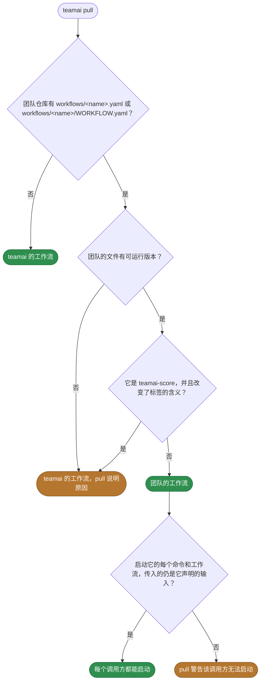
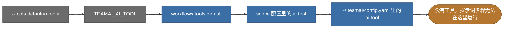

# 默认工作流

[English](README.md) | 中文

teamai 自带的工作流。这里每个 `<name>.yaml` 是一个工作流。把提示词放在文件里的工作流有一个文件夹 `<name>/WORKFLOW.yaml`，并有自己的 README。[指南](https://github.com/Tencent/teamai-cli/blob/main/docs/guide/zh-CN/workflow.md#默认工作流)说明每个工作流做什么。

## 读懂工作流的接口

文件就是接口。它的 `inputs:` 和 `outputs:` 是命令或另一个工作流传入和读取的内容。要用这里运行的版本，按 teamai 检查的方式查看输入：

```bash
teamai workflow start teamai-share-learnings --describe
```

| 文件里的键 | 它说明什么 |
|---|---|
| `inputs:`、`outputs:` | 调用方传入和读取什么。替换要保留它们 |
| `invoke:` | agent 会话能否启动这个工作流。见下表 |
| 带 `workflow: <name>` 的步骤 | 这个工作流会运行那个工作流 |
| 带 `prompt:`、`answer:` 或 `answer_file:` 的步骤 | 这个工作流需要 AI 工具 |
| 带 `scorers:` 或 `workflow: teamai-score` 的步骤 | 这个工作流需要评审者 |
| 带 `workspace: { team: ... }` 和 `deliver: pr` 的步骤 | 这个工作流推送团队仓库的一个分支，并开一个拉取请求 |
| 带 `requires: { isolation: sandbox }` 的步骤 | 这个步骤只在声明了沙箱的机器上运行 |

| `invoke` | `teamai pull` 做什么 |
|---|---|
| `allow` | 写入一个 skill，让 agent 会话能找到这个工作流。在 Claude Code 和 CodeBuddy 上，这个 skill 还会预先批准 `workflow start` 命令 |
| `ask` | 写入 skill，不预先批准 |
| `deny` | 不写 skill。只有命令或另一个工作流能启动它 |

## 替换其中一个

```bash
cp "$(npm root -g)/teamai-cli/workflows/teamai-share-learnings-from-sessions.yaml" workflows/
```

```yaml
# workflows/teamai-share-learnings-from-sessions.yaml in the team repo
invoke: allow   # let an agent session start it without asking
```

推送这个文件。下一次 `teamai pull` 会用团队的文件代替 teamai 的。替换可以改动文件里的一切：`description`、`invoke`、`alias`、提示词、步骤、步骤的顺序和每个 `timeout`。

### 运行哪个版本



### 替换要保留什么

| 工作流 | 保留 | 否则 pull |
|---|---|---|
| 每个工作流 | `inputs:` 和 `outputs:` 的名字和类型 | 使用团队的工作流，并警告调用方无法启动 |
| `teamai-score` | 每个标签的含义。见[它可以改什么](https://github.com/Tencent/teamai-cli/blob/main/docs/guide/zh-CN/scorers.md#为团队替换它) | 使用 teamai 的，并报告 `score_override_*` |
| `teamai-score` | 它的名字。另一个文件上的 `alias: teamai-score` 不会替换它 | 使用 teamai 的，并报告 `default_override_alias` |

## 哪个 AI 工具回答提示词

步骤既没写 `tool:` 也没写 `agent:` 时，下面第一个指定了工具的位置生效：



`teamai-score` 则从评分器选出评审者。见[选择评审者的模型](https://github.com/Tencent/teamai-cli/blob/main/docs/guide/zh-CN/scorers.md#选择评审者的模型)。

## 影响它们的设置

| 设置 | 团队 `teamai.yaml` | 成员配置 | 环境变量或选项 | 作用 |
|---|---|---|---|---|
| AI 工具 | | `workflows.tools.default`、`ai.tool` | `TEAMAI_AI_TOOL`、`--tools` | 按上面的顺序，选出回答每个提示词的工具 |
| 驱动 | `workflows.driver` | `workflows.driver` | | 选出命令在哪个驱动上启动运行。未设置表示本机 |
| 并行步骤 | | `workflows.max_parallel` | | 设置本地驱动同时运行多少个命令步骤 |
| 无人时的审批 | | `workflows.auto_approve` | `--auto-approve` | 对可选审批回答“是”，每个选择取默认项 |
| 沙箱 | | `workflows.sandbox` | `--sandbox` | 声明本机是沙箱，需要沙箱的步骤就能在这里运行 |
| 步骤能用什么 | | `workflows.allow: { network, env }` | | 步骤需要本机不允许的网络或 env 键时，让它等待 |
| 保留期 | | `workflows.retention` | | 设置 `teamai doctor --fix` 把已结束运行留下的分支和 worktree 保留多久 |
| Recall | `sharing.recall.enabled` | `recallEnabled` | `TEAMAI_RECALL_DISABLED=1` | 关闭时，pull 不为需要 recall 的工作流写 skill，例如 `teamai-share-learnings` |
| 会话评分 | `sessions.publish` 和 `scorers/scoring.yaml` | `sessions`、`scoring` | `TEAMAI_MODE`、`CI` | 决定 `teamai-finished-sessions` 发布和评判什么。见[已结束的会话](https://github.com/Tencent/teamai-cli/blob/main/docs/guide/zh-CN/scorers.md#已结束的会话) |

成员配置在工作区里是 `~/.teamai/projects/<slug>/config.yaml`，其次是 `~/.teamai/config.yaml`。环境变量和选项优先于成员配置，成员配置优先于团队。默认值见[成员设置](https://github.com/Tencent/teamai-cli/blob/main/docs/guide/zh-CN/reference.md#成员设置)。
