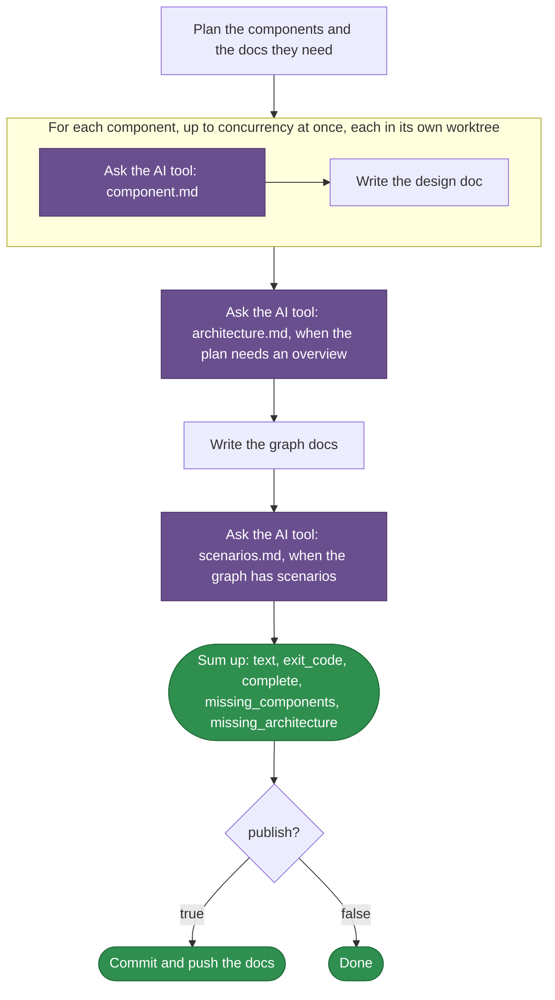

# teamai-codebase-deep-enrich

English | [中文](README.zh-CN.md)

Writes the deep knowledge docs of a codebase that `teamai import` extracted into a teamwiki. The docs go beside the codebase's evidence: a design doc for each component, the architecture overview, the graph docs and the cross-component scenarios.

| Started by | |
|---|---|
| `teamai codebase --deep-enrich --project <slug>` | One codebase |
| [`teamai-import-from-repo`](../teamai-import-from-repo/README.md) | Each repository it imports |

## How teamai's version runs



Purple marks a prompt the AI tool answers. A component whose answer fails gets no doc. The run names it, and the next run writes it. When the AI tool cannot run at all, the run fails. `WORKFLOW.yaml` holds the steps.

## Files

| File | What it is |
|---|---|
| `WORKFLOW.yaml` | The steps, and the `output:` each step declares |
| `component.md` | The prompt for each component's design doc |
| `architecture.md` | The prompt for the architecture overview |
| `scenarios.md` | The prompt for the scenario sequence diagrams |

A prompt reads `{{ inputs.<name> }}`, `{{ item.<field> }}` inside a step that runs for each component, and the outputs of the steps it needs, as `{{ steps.<id>.outputs.<field> }}`.

## Inputs

| Input | Type | Meaning |
|---|---|---|
| `wiki_root` | `string` | The teamwiki directory |
| `project` | `string` | The codebase, its directory under `evidence/code/` |
| `max_modules` | `number` | How many components get a doc. `0` means every component |
| `concurrency` | `number` | How many component docs the run writes at once |
| `publish` | `boolean` | Commit the docs and push them to the team repo that holds `wiki_root` |

## Outputs

| Output | Meaning |
|---|---|
| `text` | The summary the command prints |
| `exit_code` | `1` when a doc is missing |
| `complete` | `true` when the run wrote every doc |
| `missing_components` | The components with no doc. The next run writes them |
| `missing_architecture` | `true` when the architecture overview is missing |

## Replace it

```bash
cp -r "$(npm root -g)/teamai-cli/workflows/teamai-codebase-deep-enrich" workflows/
```

Then edit the prompts, such as adding this to `component.md`:

```markdown
End each design doc with a "Failure modes" section that lists what the component does when a dependency is down.
```

Push the folder. The next `teamai pull` uses the team's folder, as a whole, instead of teamai's. `teamai-import-from-repo` then runs the team's folder too.

| Keep | Why |
|---|---|
| Every file `WORKFLOW.yaml` names | The team's folder replaces teamai's as a whole |
| The inputs and outputs above | The callers pass those inputs and read those outputs |

## Requires

| Needs | Without it |
|---|---|
| An AI tool | When a tool named in the settings cannot run, the run fails |

## Settings that change it

| Setting | Team `teamai.yaml` | Member config | Environment | Effect |
|---|---|---|---|---|
| AI tool | | `workflows.tools.default`, then `ai.tool` | `TEAMAI_AI_TOOL`, before both | Picks the tool that writes each doc |
| Driver | `workflows.driver` | `workflows.driver` | | Picks the driver `teamai codebase --deep-enrich` starts its run on. Unset means this machine |
| Retention | | `workflows.retention` | | Sets how long `teamai doctor --fix` leaves the worktrees and branches of the answers |

The member config is `~/.teamai/projects/<slug>/config.yaml` in a workspace, then `~/.teamai/config.yaml`. The environment wins over the member config, and the member config wins over the team. See [member settings](https://github.com/Tencent/teamai-cli/blob/main/docs/guide/reference.md#member-settings) for the defaults.
