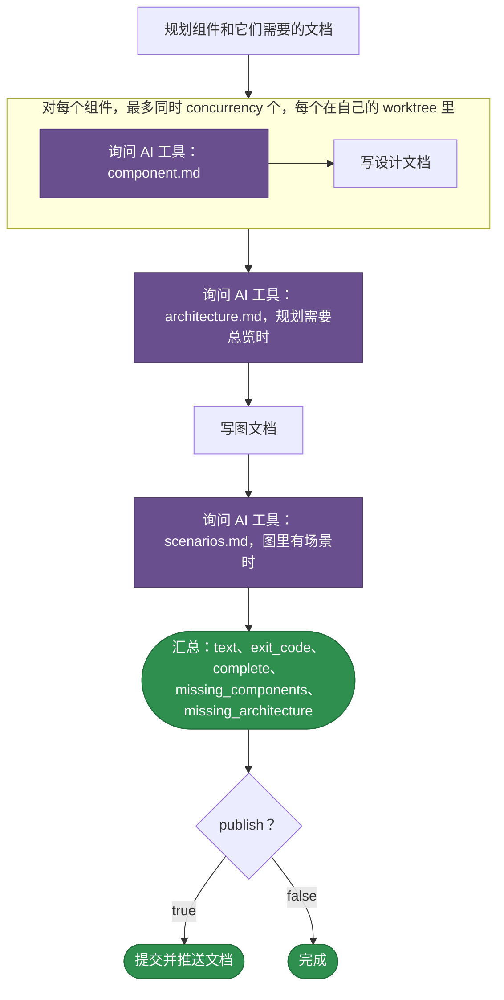

# teamai-codebase-deep-enrich

[English](README.md) | 中文

为 `teamai import` 已提取到 teamwiki 的代码库编写深度知识文档。文档放在代码库的证据旁边：每个组件的设计文档、架构总览、图文档和跨组件场景。

| 启动方式 | |
|---|---|
| `teamai codebase --deep-enrich --project <slug>` | 一个代码库 |
| [`teamai-import-from-repo`](../teamai-import-from-repo/README.zh-CN.md) | 它导入的每个仓库 |

## teamai 的版本如何运行



紫色表示由 AI 工具回答的提示词。回答失败的组件没有文档。运行会列出它，下一次运行会补写。AI 工具完全无法运行时，运行失败。`WORKFLOW.yaml` 保存这些步骤。

## 文件

| 文件 | 是什么 |
|---|---|
| `WORKFLOW.yaml` | 步骤，以及每个步骤声明的 `output:` |
| `component.md` | 每个组件设计文档的提示词 |
| `architecture.md` | 架构总览的提示词 |
| `scenarios.md` | 场景时序图的提示词 |

提示词读取 `{{ inputs.<name> }}`；在为每个组件运行一次的步骤里读取 `{{ item.<field> }}`；还以 `{{ steps.<id>.outputs.<field> }}` 的形式，读取它依赖的步骤的输出。

## 输入

| 输入 | 类型 | 含义 |
|---|---|---|
| `wiki_root` | `string` | teamwiki 目录 |
| `project` | `string` | 代码库，即它在 `evidence/code/` 下的目录 |
| `max_modules` | `number` | 为多少个组件写文档。`0` 表示所有组件 |
| `concurrency` | `number` | 运行同时写多少份组件文档 |
| `publish` | `boolean` | 提交文档，并推送到存放 `wiki_root` 的团队仓库 |

## 输出

| 输出 | 含义 |
|---|---|
| `text` | 命令打印的摘要 |
| `exit_code` | 有文档缺失时为 `1` |
| `complete` | 运行写完了所有文档时为 `true` |
| `missing_components` | 没有文档的组件。下一次运行会补写 |
| `missing_architecture` | 缺少架构总览时为 `true` |

## 替换它

```bash
cp -r "$(npm root -g)/teamai-cli/workflows/teamai-codebase-deep-enrich" workflows/
```

然后编辑提示词，例如在 `component.md` 里加上这一句：

```markdown
End each design doc with a "Failure modes" section that lists what the component does when a dependency is down.
```

推送这个文件夹。下一次 `teamai pull` 会用团队的文件夹整体代替 teamai 的。之后 `teamai-import-from-repo` 运行的也是团队的文件夹。

| 保留 | 原因 |
|---|---|
| `WORKFLOW.yaml` 引用的每个文件 | 团队的文件夹整体替换 teamai 的 |
| 上面的输入和输出 | 调用方会传这些输入、读这些输出 |

## 依赖

| 需要 | 没有时 |
|---|---|
| AI 工具 | 设置里指定的工具无法运行时，运行失败 |

## 影响它的设置

| 设置 | 团队 `teamai.yaml` | 成员配置 | 环境变量 | 作用 |
|---|---|---|---|---|
| AI 工具 | | `workflows.tools.default`，其次是 `ai.tool` | `TEAMAI_AI_TOOL`，优先于两者 | 选出编写每份文档的工具 |
| 驱动 | `workflows.driver` | `workflows.driver` | | 选出 `teamai codebase --deep-enrich` 在哪个驱动上启动运行。未设置表示本机 |
| 保留期 | | `workflows.retention` | | 设置 `teamai doctor --fix` 把回答留下的 worktree 和分支保留多久 |

成员配置在工作区里是 `~/.teamai/projects/<slug>/config.yaml`，其次是 `~/.teamai/config.yaml`。环境变量优先于成员配置，成员配置优先于团队。默认值见[成员设置](https://github.com/Tencent/teamai-cli/blob/main/docs/guide/zh-CN/reference.md#成员设置)。
