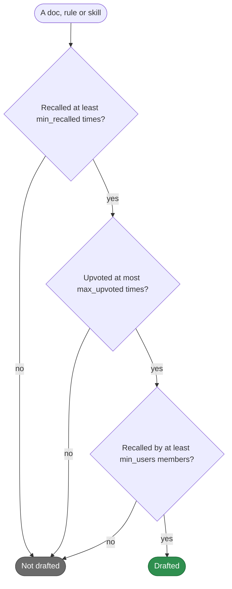
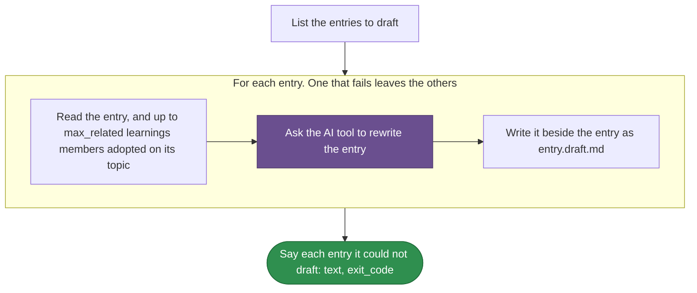

# teamai-draft-learning-updates

English | [中文](README.zh-CN.md)

Drafts an update of each doc, rule and skill the team recalls often but rarely adopts. The AI tool rewrites the entry with the learnings members adopted instead, and teamai writes the draft beside it as `<entry>.draft.md` for a person to review.

| Started by | |
|---|---|
| `teamai recall maintenance --update-quality` | `--dry-run` lists the entries and starts no run |
| An agent session | Never by name: `invoke: deny`. The command runs it from an agent session too |

## Which entries it drafts



The counts add every member's votes. `--update-quality --dry-run`, the `stale` step and the dashboard's maintenance view list the same entries, from the same `params.yaml`.

## How teamai's version runs



Purple marks a prompt the AI tool answers. `WORKFLOW.yaml` holds the steps.

## Files

| File | What it is |
|---|---|
| `WORKFLOW.yaml` | The steps, and the `output:` each step declares |
| `params.yaml` | Which entries it drafts, and how many adopted learnings each prompt shows |

## Inputs

| Input | Type | Meaning |
|---|---|---|
| `knowledge_root` | `string` | The checkout holding the entries, the team repo or a project's `.teamai/`. The drafts are written in it |

## Outputs

| Output | Meaning |
|---|---|
| `text` | Each entry it could not draft, and what to do with the drafts |
| `exit_code` | `1` when an entry could not be drafted. The other entries still get theirs |

## Parameters

| Key | Range | What it sets |
|---|---|---|
| `min_recalled` | 1-1000 | The recalls an entry needs, from every member together |
| `max_upvoted` | 0-1000 | The most upvotes it may have, from every member together |
| `min_users` | 1-1000 | The members who must have recalled it |
| `max_related` | 0-20 | How many adopted learnings the prompt shows. `0` shows none |

## Replace it

Put only the files you change in `workflows/teamai-draft-learning-updates/` at the root of the team repo. Every other file, `WORKFLOW.yaml` included, stays teamai's and keeps getting teamai's updates. A small team that wants an entry one member keeps recalling drafted too:

```yaml
# workflows/teamai-draft-learning-updates/params.yaml
min_users: 1   # the other keys keep teamai's values
```

Push the folder. After the next `teamai pull`, the listing, the steps and the dashboard all use it. A key you leave out of `params.yaml` keeps teamai's value from its `params.yaml`.

A `WORKFLOW.yaml` of your own in the folder replaces the steps, and `params.yaml` still decides which entries the `stale` step lists. A `workflows/teamai-draft-learning-updates.yaml` file replaces the folder whole, so teamai's parameters apply.

| Keep | Why |
|---|---|
| The inputs and outputs above | `teamai recall maintenance --update-quality` passes that input and reads those outputs |

## What pull refuses

| A team folder that | Pull |
|---|---|
| Sets a value out of range, or a key the table above does not list | Names the file and the field. The version pull last took stays in force, teamai's until it took one |

`teamai review --branch` fails such a folder before you merge it.

## Requires

| Needs | Without it |
|---|---|
| An AI tool | The entry is not drafted, and the others go on. The command exits 1 |

## Settings that change it

| Setting | Team `teamai.yaml` | Member config | Environment | Effect |
|---|---|---|---|---|
| AI tool | | `workflows.tools.default`, then `ai.tool` | `TEAMAI_AI_TOOL`, before both | Picks the tool that rewrites the entries |
| Driver | `workflows.driver` | `workflows.driver` | | Picks where the command starts the run. Unset means this machine |

The member config is `~/.teamai/projects/<slug>/config.yaml` in a workspace, then `~/.teamai/config.yaml`. The environment wins over the member config, and the member config wins over the team. See [member settings](https://github.com/Tencent/teamai-cli/blob/main/docs/guide/reference.md#member-settings) for the defaults.
