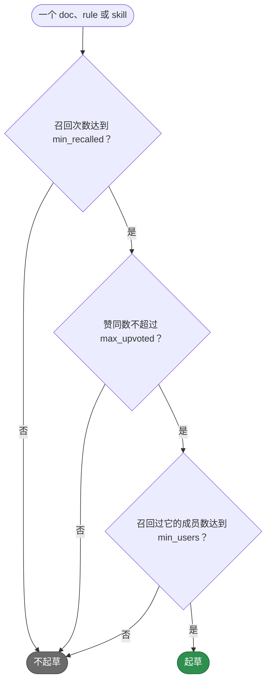
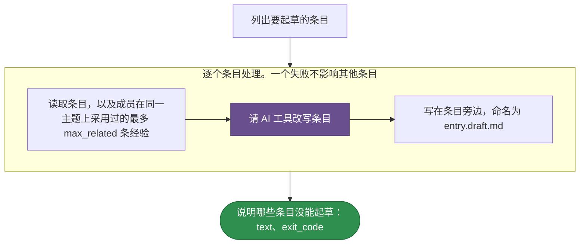

# teamai-draft-learning-updates

[English](README.md) | 中文

为团队经常召回却很少采用的每个 doc、rule 和 skill 起草更新。AI 工具参考成员实际采用的经验改写条目，teamai 把草稿写在条目旁边，命名为 `<entry>.draft.md`，供成员审阅。

| 启动方式 | |
|---|---|
| `teamai recall maintenance --update-quality` | `--dry-run` 只列出条目，不启动运行 |
| agent 会话 | 从不按名称启动：`invoke: deny`。该命令在 agent 会话中也能运行它 |

## 哪些条目会被起草



计数把所有成员的投票加在一起。`--update-quality --dry-run`、`stale` 步骤和 dashboard 的维护视图列出的是同一批条目，读的都是同一个 `params.yaml`。

## teamai 的版本如何运行



紫色表示由 AI 工具回答的提示词。`WORKFLOW.yaml` 保存这些步骤。

## 文件

| 文件 | 是什么 |
|---|---|
| `WORKFLOW.yaml` | 步骤，以及每个步骤声明的 `output:` |
| `params.yaml` | 起草哪些条目，以及每个提示词展示多少条已采用的经验 |

## 输入

| 输入 | 类型 | 含义 |
|---|---|---|
| `knowledge_root` | `string` | 存放这些条目的 checkout，即团队仓库或项目的 `.teamai/`。草稿写在其中 |

## 输出

| 输出 | 含义 |
|---|---|
| `text` | 没能起草的每个条目，以及如何处理草稿 |
| `exit_code` | 有条目没能起草时为 `1`。其他条目仍会得到草稿 |

## 参数

| 键 | 范围 | 设置什么 |
|---|---|---|
| `min_recalled` | 1-1000 | 所有成员加起来至少要召回多少次 |
| `max_upvoted` | 0-1000 | 所有成员加起来最多能有多少个赞同 |
| `min_users` | 1-1000 | 至少要多少位成员召回过它 |
| `max_related` | 0-20 | 提示词展示多少条已采用的经验。`0` 表示不展示 |

## 替换它

在团队仓库根目录的 `workflows/teamai-draft-learning-updates/` 里只放你要改的文件。其他文件（包括 `WORKFLOW.yaml`）仍用 teamai 的，并继续获得 teamai 的更新。小团队希望某位成员反复召回的条目也被起草：

```yaml
# workflows/teamai-draft-learning-updates/params.yaml
min_users: 1   # the other keys keep teamai's values
```

推送这个文件夹。下一次 `teamai pull` 之后，列表、步骤和 dashboard 都用它。`params.yaml` 里没写的键，沿用 teamai 的 `params.yaml` 里的值。

文件夹里放你自己的 `WORKFLOW.yaml` 会替换步骤，`params.yaml` 仍决定 `stale` 步骤列出哪些条目。`workflows/teamai-draft-learning-updates.yaml` 单个文件会整体替换这个文件夹，此时用 teamai 的参数。

| 保留 | 原因 |
|---|---|
| 上面的输入和输出 | `teamai recall maintenance --update-quality` 会传这个输入、读这些输出 |

## pull 拒绝什么

| 团队文件夹 | pull 的处理 |
|---|---|
| 设置了超出范围的值，或上表没有列出的键 | 指出文件和字段。pull 上一次接受的版本继续生效，还没接受过时用 teamai 的 |

`teamai review --branch` 会在合并前让这样的文件夹不通过。

## 依赖

| 需要 | 没有时 |
|---|---|
| AI 工具 | 该条目不会被起草，其他条目继续。命令以 1 退出 |

## 影响它的设置

| 设置 | 团队 `teamai.yaml` | 成员配置 | 环境变量 | 作用 |
|---|---|---|---|---|
| AI 工具 | | `workflows.tools.default`，其次是 `ai.tool` | `TEAMAI_AI_TOOL`，优先于两者 | 选出改写条目的工具 |
| 驱动 | `workflows.driver` | `workflows.driver` | | 选出命令在哪里启动运行。未设置表示本机 |

成员配置在工作区里是 `~/.teamai/projects/<slug>/config.yaml`，其次是 `~/.teamai/config.yaml`。环境变量优先于成员配置，成员配置优先于团队。默认值见[成员设置](https://github.com/Tencent/teamai-cli/blob/main/docs/guide/zh-CN/reference.md#成员设置)。
