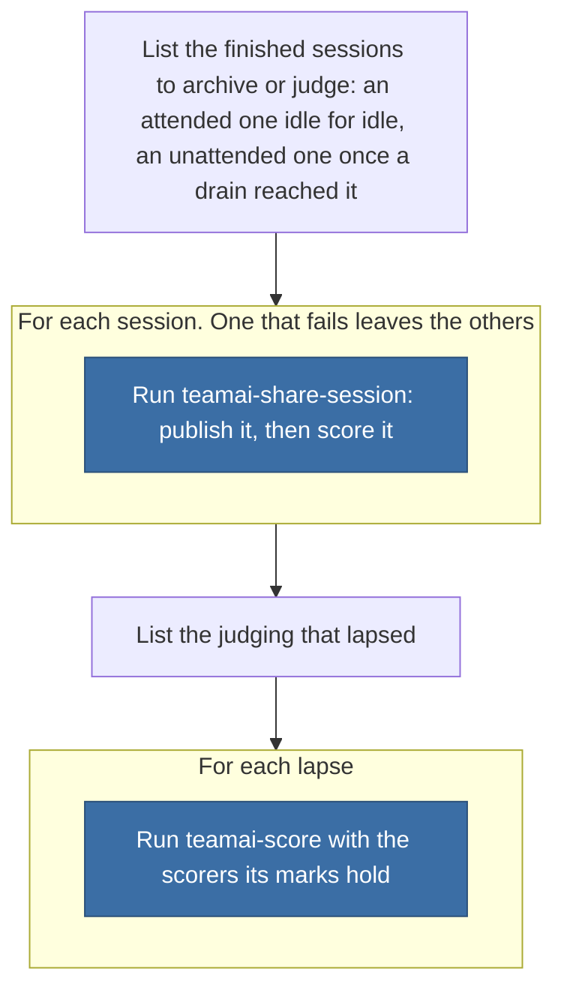

# teamai-finished-sessions

English | [中文](README.zh-CN.md)

Archives and scores this machine's finished sessions, as the team's session policies say, and starts again the judging that lapsed.

| Started by | Inputs |
|---|---|
| A session start, in the background | `{"publish":"policy","scorers":[]}` |
| `teamai score --drain` | `{"publish":"policy","scorers":[]}` |
| `teamai workflow start teamai-finished-sessions` from your own terminal | Any. Only a run a person started may pass other inputs |
| An agent session | Never by name: `invoke: deny` |

## How teamai's version runs



Blue marks another default workflow, which a team can replace too. `WORKFLOW.yaml` holds the steps. A run ends after its `timeout`, 30 minutes, and what it cancels lapses, so the next run starts it again.

## Files

| File | What it is |
|---|---|
| `WORKFLOW.yaml` | The steps, the `timeout`, and the `output:` each step declares |
| `params.yaml` | How long an attended session is idle before it is finished |

## Inputs

| Input | Type | Meaning |
|---|---|---|
| `publish` | `policy \| always \| never` | `policy` lets `sessions.publish` decide for each session's run mode |
| `scorers` | `[string]` | The scorers that judge each finished session, unsampled. `[]` lets `scoring.sessions` decide |

## Outputs

None. Each session's publishing and scoring are recorded where `teamai-share-session` and `teamai-score` keep them.

## Parameters

| Key | Range | What it sets |
|---|---|---|
| `idle` | `10m`-`7d` | How long nothing happens in an attended session before it is finished, such as `6h` |

The dashboard, the share proposals of `teamai-share-session` and the usage report's outcomes count a session finished at the same `idle`. `teamai session list --finished --idle <duration>` overrides it for one listing.

## Replace it

Put only the files you change in `workflows/teamai-finished-sessions/` at the root of the team repo. Every other file, `WORKFLOW.yaml` included, stays teamai's and keeps getting teamai's updates. A team whose sessions are short, and wants them judged the same afternoon:

```yaml
# workflows/teamai-finished-sessions/params.yaml
idle: 1h
```

Push the folder. After the next `teamai pull`, every reader above uses it.

A `WORKFLOW.yaml` of your own in the folder replaces the steps and the `timeout`, and `params.yaml` still decides when a session is finished. A `workflows/teamai-finished-sessions.yaml` file replaces the folder whole, so teamai's `idle` applies.

| Keep | Why |
|---|---|
| The inputs above | A session start and `teamai score --drain` pass them |
| A `sessions` step running `teamai session list --finished` | Its refusal of other inputs in a run no person started is what keeps an automatic start to the policies |

## What pull refuses

| A team folder that | Pull |
|---|---|
| Sets an `idle` that is not a duration from `10m` to `7d`, or a key the table above does not list | Names the file and the field. The version pull last took stays in force, teamai's until it took one |

`teamai review --branch` fails such a folder before you merge it.

## Requires

| Needs | Without it |
|---|---|
| A scorer that sets `sessions: true` | Nothing is judged. Publishing still follows `sessions.publish` |
| A team repo kept by git | No session is archived, since an HTTP team repo keeps no session archive |

## Settings that change it

| Setting | Team `teamai.yaml` | Member config | Environment | Effect |
|---|---|---|---|---|
| Publishing | `sessions.publish` | `sessions.publish` | | Decides, per run mode, whether a finished session is archived |
| Scoring | `sessions` in `scorers/scoring.yaml` | `scoring.sessions` | | Decides, per run mode, whether a finished session is judged, up to `daily_limit` |
| Run mode | | | `TEAMAI_MODE`, then `CI` | Decides whether a session is attended, and finishes at `idle`, or unattended, and finishes at a drain |
| Driver | `workflows.driver` | `workflows.driver` | | Picks where `teamai score --drain` starts the run. Unset means this machine |

The member config is `~/.teamai/projects/<slug>/config.yaml` in a workspace, then `~/.teamai/config.yaml`. The environment wins over the member config, and the member config wins over the team. See [member settings](https://github.com/Tencent/teamai-cli/blob/main/docs/guide/reference.md#member-settings) for the defaults.
