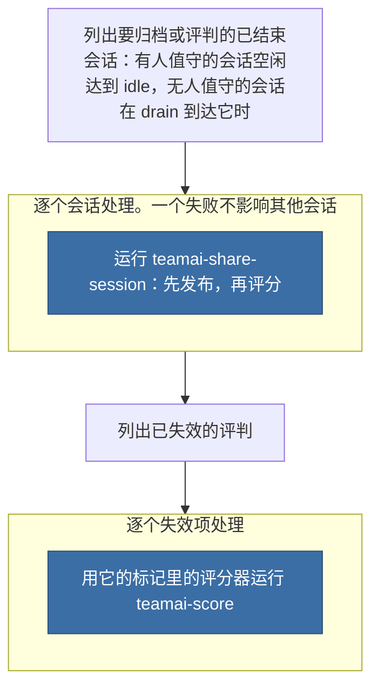

# teamai-finished-sessions

[English](README.md) | 中文

按团队的会话策略归档并评判本机已结束的会话，并重新开始已失效的评判。

| 启动方式 | 输入 |
|---|---|
| 会话启动时，在后台 | `{"publish":"policy","scorers":[]}` |
| `teamai score --drain` | `{"publish":"policy","scorers":[]}` |
| 在你自己的终端运行 `teamai workflow start teamai-finished-sessions` | 任意。只有成员启动的运行可以传其他输入 |
| agent 会话 | 从不按名称启动：`invoke: deny` |

## teamai 的版本如何运行



蓝色表示另一个默认工作流，团队也可以替换它。`WORKFLOW.yaml` 保存这些步骤。一次运行在 `timeout`（30 分钟）后结束，被取消的部分会失效，下一次运行会重新开始它。

## 文件

| 文件 | 是什么 |
|---|---|
| `WORKFLOW.yaml` | 步骤、`timeout`，以及每个步骤声明的 `output:` |
| `params.yaml` | 有人值守的会话空闲多久后算作已结束 |

## 输入

| 输入 | 类型 | 含义 |
|---|---|---|
| `publish` | `policy \| always \| never` | `policy` 表示按每个会话的运行模式由 `sessions.publish` 决定 |
| `scorers` | `[string]` | 评判每个已结束会话的评分器，不抽样。`[]` 表示由 `scoring.sessions` 决定 |

## 输出

无。每个会话的发布和评分记录在 `teamai-share-session` 和 `teamai-score` 保存它们的地方。

## 参数

| 键 | 范围 | 设置什么 |
|---|---|---|
| `idle` | `10m`-`7d` | 有人值守的会话多久没有任何活动后算作已结束，例如 `6h` |

dashboard、`teamai-share-session` 的分享提议和用量报告的产出，都按同一个 `idle` 把会话算作已结束。`teamai session list --finished --idle <duration>` 只对这一次列出覆盖它。

## 替换它

在团队仓库根目录的 `workflows/teamai-finished-sessions/` 里只放你要改的文件。其他文件（包括 `WORKFLOW.yaml`）仍用 teamai 的，并继续获得 teamai 的更新。会话都很短、希望当天下午就评判的团队：

```yaml
# workflows/teamai-finished-sessions/params.yaml
idle: 1h
```

推送这个文件夹。下一次 `teamai pull` 之后，上面所有读取它的地方都用它。

文件夹里放你自己的 `WORKFLOW.yaml` 会替换步骤和 `timeout`，`params.yaml` 仍决定会话何时算作已结束。`workflows/teamai-finished-sessions.yaml` 单个文件会整体替换这个文件夹，此时用 teamai 的 `idle`。

| 保留 | 原因 |
|---|---|
| 上面的输入 | 会话启动和 `teamai score --drain` 会传这些输入 |
| 运行 `teamai session list --finished` 的 `sessions` 步骤 | 它会拒绝非成员启动的运行传入的其他输入，自动启动因此只能按策略处理 |

## pull 拒绝什么

| 团队文件夹 | pull 的处理 |
|---|---|
| 设置的 `idle` 不是 `10m` 到 `7d` 之间的时长，或上表没有列出的键 | 指出文件和字段。pull 上一次接受的版本继续生效，还没接受过时用 teamai 的 |

`teamai review --branch` 会在合并前让这样的文件夹不通过。

## 依赖

| 需要 | 没有时 |
|---|---|
| 设置了 `sessions: true` 的评分器 | 不评判任何会话。发布仍按 `sessions.publish` |
| 用 git 保存的团队仓库 | 不归档任何会话，因为 HTTP 团队仓库不保存会话存档 |

## 影响它的设置

| 设置 | 团队 `teamai.yaml` | 成员配置 | 环境变量 | 作用 |
|---|---|---|---|---|
| 发布 | `sessions.publish` | `sessions.publish` | | 按运行模式决定已结束的会话是否归档 |
| 评分 | `scorers/scoring.yaml` 的 `sessions` | `scoring.sessions` | | 按运行模式决定已结束的会话是否评判，上限为 `daily_limit` |
| 运行模式 | | | `TEAMAI_MODE`，其次是 `CI` | 决定会话是有人值守（空闲达到 `idle` 时结束）还是无人值守（drain 到达时结束） |
| 驱动 | `workflows.driver` | `workflows.driver` | | 选出 `teamai score --drain` 在哪里启动运行。未设置表示本机 |

成员配置在工作区里是 `~/.teamai/projects/<slug>/config.yaml`，其次是 `~/.teamai/config.yaml`。环境变量优先于成员配置，成员配置优先于团队。默认值见[成员设置](https://github.com/Tencent/teamai-cli/blob/main/docs/guide/zh-CN/reference.md#成员设置)。
