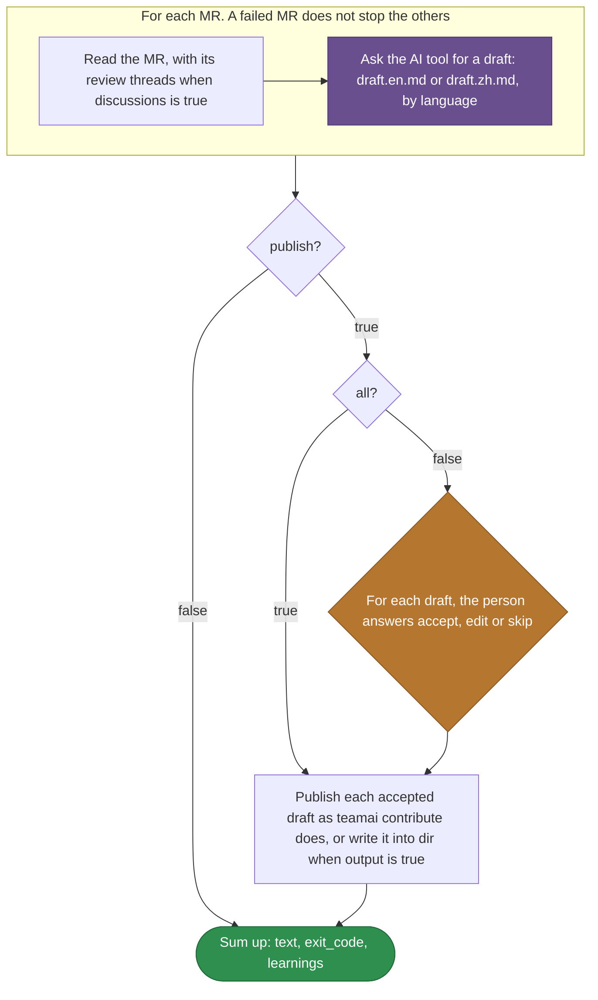

# teamai-import-from-mr

English | [中文](README.zh-CN.md)

Turns merged MRs or PRs into team learnings. The AI tool drafts one learning per MR. A person accepts, edits or skips each draft. teamai publishes the accepted ones as `teamai contribute` does.

| Started by | |
|---|---|
| `teamai import --from-mr <url>...` | One URL or more |
| `teamai ci extract-mr` | Through `teamai-ci-extract-mr` |
| The [MR hint](../../hooks/teamai-mr-hint/README.md) | An offer the agent can start at session start |

## How teamai's version runs



Purple marks a prompt the AI tool answers. Orange marks a question for a person. An edited draft is published with the person's note as its title. `WORKFLOW.yaml` holds the steps.

## Files

| File | What it is |
|---|---|
| `WORKFLOW.yaml` | The steps, and the `output:` each step declares |
| `draft.en.md`, `draft.zh.md` | The prompt for each MR, picked by `language` |

A prompt reads the outputs of the steps it needs, as `{{ steps.<id>.outputs.<field> }}`.

## Inputs

| Input | Type | Meaning |
|---|---|---|
| `mrs` | `[string]` | The MR or PR URLs |
| `all` | `boolean` | Accept every draft without asking |
| `publish` | `boolean` | When `false`, the run writes and pushes nothing, and the drafts are only its outputs |
| `dir` | `string` | The team repo. With `output`, the directory each draft goes in |
| `output` | `boolean` | Write the drafts as files into `dir` |
| `discussions` | `boolean` | Read the MRs' review threads |
| `language` | `en \| zh` | Picks the draft prompt |

## Outputs

| Output | Meaning |
|---|---|
| `text` | The summary the command prints |
| `exit_code` | `1` when an MR failed. The other MRs still finish |
| `learnings` | The `url`, `title`, `file` and `repo_url` of each published learning |

## Replace it

```bash
cp -r "$(npm root -g)/teamai-cli/workflows/teamai-import-from-mr" workflows/
```

Then edit the prompts, such as adding this to `draft.en.md`:

```markdown
Name the service the MR changes in the title, such as "billing: ...".
```

Push the folder. The next `teamai pull` uses the team's folder, as a whole, instead of teamai's.

| Keep | Why |
|---|---|
| Every file `WORKFLOW.yaml` names | The team's folder replaces teamai's as a whole |
| The inputs and outputs above | The commands pass those inputs and read those outputs |

## Requires

| Needs | Without it |
|---|---|
| An AI tool | The draft steps fail |
| A person at the review, unless `all` is `true` | An unattended run cannot answer the review |
| Read access to each MR from this machine | That MR fails, and the others go on |

## Settings that change it

| Setting | Team `teamai.yaml` | Member config | Environment | Effect |
|---|---|---|---|---|
| AI tool | | `workflows.tools.default`, then `ai.tool` | `TEAMAI_AI_TOOL`, before both | Picks the tool that writes each draft |
| Driver | `workflows.driver` | `workflows.driver` | | Picks where the command starts the run. Unset means this machine |
| Language | `language` | | | The commands pass it as the `language` input |
| MR hint | `sharing.mrHint.enabled` | `mrHintEnabled` | `TEAMAI_MR_HINT_DISABLED=1` | Decides whether session start offers this workflow |

The member config is `~/.teamai/projects/<slug>/config.yaml` in a workspace, then `~/.teamai/config.yaml`. The environment wins over the member config, and the member config wins over the team. See [member settings](https://github.com/Tencent/teamai-cli/blob/main/docs/guide/reference.md#member-settings) for the defaults.
