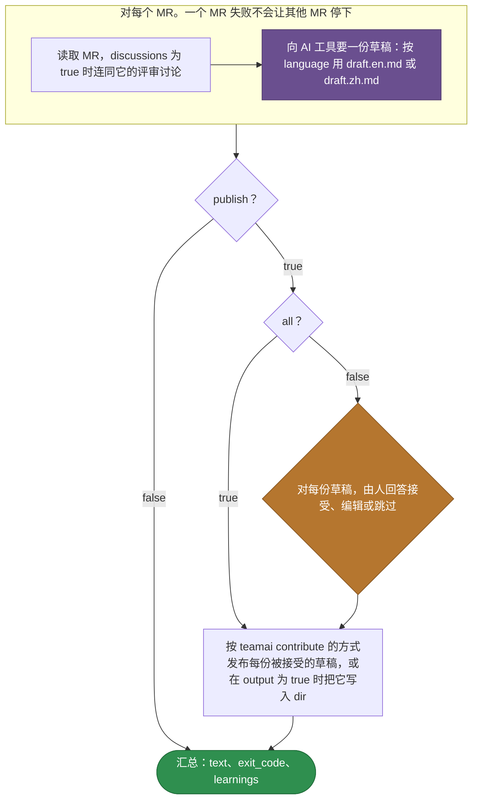

# teamai-import-from-mr

[English](README.md) | 中文

把已合并的 MR 或 PR 整理成团队 learning。AI 工具为每个 MR 起草一条 learning。由人接受、编辑或跳过每份草稿。teamai 按 `teamai contribute` 的方式发布被接受的草稿。

| 启动方式 | |
|---|---|
| `teamai import --from-mr <url>...` | 一个或多个 URL |
| `teamai ci extract-mr` | 通过 `teamai-ci-extract-mr` |
| [MR 提示](../../hooks/teamai-mr-hint/README.zh-CN.md) | 会话开始时 agent 可以启动的提议 |

## teamai 的版本如何运行



紫色表示由 AI 工具回答的提示词。橙色表示要问人的问题。编辑过的草稿以这个人的备注作为标题发布。`WORKFLOW.yaml` 保存这些步骤。

## 文件

| 文件 | 是什么 |
|---|---|
| `WORKFLOW.yaml` | 步骤，以及每个步骤声明的 `output:` |
| `draft.en.md`、`draft.zh.md` | 每个 MR 的提示词，按 `language` 选用 |

提示词以 `{{ steps.<id>.outputs.<field> }}` 的形式，读取它依赖的步骤的输出。

## 输入

| 输入 | 类型 | 含义 |
|---|---|---|
| `mrs` | `[string]` | MR 或 PR 的 URL |
| `all` | `boolean` | 不询问，接受每份草稿 |
| `publish` | `boolean` | 为 `false` 时，运行不写入也不推送任何东西，草稿只作为它的输出 |
| `dir` | `string` | 团队仓库。配合 `output` 时，是每份草稿写入的目录 |
| `output` | `boolean` | 把草稿作为文件写入 `dir` |
| `discussions` | `boolean` | 读取 MR 的评审讨论 |
| `language` | `en \| zh` | 选择草稿提示词 |

## 输出

| 输出 | 含义 |
|---|---|
| `text` | 命令打印的摘要 |
| `exit_code` | 有 MR 失败时为 `1`。其他 MR 仍会完成 |
| `learnings` | 每条已发布 learning 的 `url`、`title`、`file` 和 `repo_url` |

## 替换它

```bash
cp -r "$(npm root -g)/teamai-cli/workflows/teamai-import-from-mr" workflows/
```

然后编辑提示词，例如在 `draft.en.md` 里加上这一句：

```markdown
Name the service the MR changes in the title, such as "billing: ...".
```

推送这个文件夹。下一次 `teamai pull` 会用团队的文件夹整体代替 teamai 的。

| 保留 | 原因 |
|---|---|
| `WORKFLOW.yaml` 引用的每个文件 | 团队的文件夹整体替换 teamai 的 |
| 上面的输入和输出 | 命令会传这些输入、读这些输出 |

## 依赖

| 需要 | 没有时 |
|---|---|
| AI 工具 | 起草步骤失败 |
| 评审时有人在场，除非 `all` 为 `true` | 无人值守的运行无法回答评审 |
| 本机能读取每个 MR | 该 MR 失败，其他 MR 继续 |

## 影响它的设置

| 设置 | 团队 `teamai.yaml` | 成员配置 | 环境变量 | 作用 |
|---|---|---|---|---|
| AI 工具 | | `workflows.tools.default`，其次是 `ai.tool` | `TEAMAI_AI_TOOL`，优先于两者 | 选出起草每份草稿的工具 |
| 驱动 | `workflows.driver` | `workflows.driver` | | 选出命令在哪里启动运行。未设置表示本机 |
| 语言 | `language` | | | 命令把它作为 `language` 输入传入 |
| MR 提示 | `sharing.mrHint.enabled` | `mrHintEnabled` | `TEAMAI_MR_HINT_DISABLED=1` | 决定会话开始时是否提议这个工作流 |

成员配置在工作区里是 `~/.teamai/projects/<slug>/config.yaml`，其次是 `~/.teamai/config.yaml`。环境变量优先于成员配置，成员配置优先于团队。默认值见[成员设置](https://github.com/Tencent/teamai-cli/blob/main/docs/guide/zh-CN/reference.md#成员设置)。
