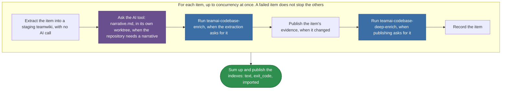

# teamai-import-from-repo

English | [中文](README.zh-CN.md)

Imports repositories or local checkouts into a teamwiki. When every item is done, it refreshes the teamwiki indexes and publishes them once.

| Started by | `mode` |
|---|---|
| `teamai import --dir <path>` | `dir` |
| `teamai import --from-repo <url>` | `repo` |
| `teamai import --from-repo-list <file>` | `list` |
| `teamai import --from-org <org>` | `org` |

## How teamai's version runs



Purple marks a prompt the AI tool answers. Blue marks another default workflow, which a team can replace too. `WORKFLOW.yaml` holds the steps.

| When | What happens to the item |
|---|---|
| The AI tool cannot run at all | It fails before anything is published |
| The narrative fails for another reason | teamai publishes the evidence without the narrative |
| The deep docs fail | teamai publishes the evidence, and records that the deep docs did not finish |

## Files

| File | What it is |
|---|---|
| `WORKFLOW.yaml` | The steps, and the `output:` each step declares |
| `narrative.md` | The prompt for a repository's `codebase.md` |

A prompt reads the outputs of the steps it needs, as `{{ steps.<id>.outputs.<field> }}`.

## Inputs

| Input | Type | Meaning |
|---|---|---|
| `wiki_root` | `string` | The teamwiki every item goes in |
| `mode` | `dir \| repo \| list \| org \| update \| ci` | The command that started the run. It decides how the batch is published and summed up |
| `items` | `[{ kind, source, domain, auth, slug, repo_url, mr_urls }]` | Each a remote repository (`kind: repo`, `source` a URL) or a local checkout (`kind: dir`, `source` a directory) |
| `settings` | `{ depth, ssh, incremental, skip_enrich, max_files, team_repo }` | The command's import options. `team_repo` is the team repo that holds `wiki_root` |
| `skipped` | `number` | How many items the command left out before the run. The summary counts them |
| `concurrency` | `number` | How many items the run imports at once |

## Outputs

| Output | Meaning |
|---|---|
| `text` | The summary the command prints |
| `exit_code` | `1` when an item failed. The other items still finish |
| `imported` | The `source`, `slug`, `updated` and `failed` of each item |

## Replace it

```bash
cp -r "$(npm root -g)/teamai-cli/workflows/teamai-import-from-repo" workflows/
```

Then edit the prompt, such as adding this to `narrative.md`:

```markdown
Add a "How to run it locally" section with the commands the README gives.
```

Push the folder. The next `teamai pull` uses the team's folder, as a whole, instead of teamai's.

| Keep | Why |
|---|---|
| Every file `WORKFLOW.yaml` names | The team's folder replaces teamai's as a whole |
| The inputs and outputs above | The commands pass those inputs and read those outputs |

## Requires

| Needs | Without it |
|---|---|
| An AI tool | When a tool named in the settings cannot run, the item fails before anything is published |
| Access to each remote `source`, as its `auth` says | That item fails, and the others go on |

## Settings that change it

| Setting | Team `teamai.yaml` | Member config | Environment | Effect |
|---|---|---|---|---|
| AI tool | | `workflows.tools.default`, then `ai.tool` | `TEAMAI_AI_TOOL`, before both | Picks the tool that writes the narrative and answers the two enrich workflows |
| Driver | `workflows.driver` | `workflows.driver` | | Picks where the command starts the run. Unset means this machine |
| Retention | | `workflows.retention` | | Sets how long `teamai doctor --fix` leaves the worktrees and branches of the answers |

The member config is `~/.teamai/projects/<slug>/config.yaml` in a workspace, then `~/.teamai/config.yaml`. The environment wins over the member config, and the member config wins over the team. See [member settings](https://github.com/Tencent/teamai-cli/blob/main/docs/guide/reference.md#member-settings) for the defaults.
