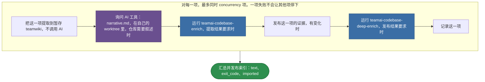

# teamai-import-from-repo

[English](README.md) | 中文

把仓库或本地检出导入 teamwiki。每一项都完成后，它刷新 teamwiki 的索引，并统一发布一次。

| 启动方式 | `mode` |
|---|---|
| `teamai import --dir <path>` | `dir` |
| `teamai import --from-repo <url>` | `repo` |
| `teamai import --from-repo-list <file>` | `list` |
| `teamai import --from-org <org>` | `org` |

## teamai 的版本如何运行



紫色表示由 AI 工具回答的提示词。蓝色表示另一个默认工作流，团队也可以替换它。`WORKFLOW.yaml` 保存这些步骤。

| 情况 | 这一项会怎样 |
|---|---|
| AI 工具完全无法运行 | 在发布任何内容之前失败 |
| 叙述因其他原因失败 | teamai 发布不带叙述的证据 |
| 深度文档失败 | teamai 发布证据，并记录深度文档没有完成 |

## 文件

| 文件 | 是什么 |
|---|---|
| `WORKFLOW.yaml` | 步骤，以及每个步骤声明的 `output:` |
| `narrative.md` | 仓库 `codebase.md` 的提示词 |

提示词以 `{{ steps.<id>.outputs.<field> }}` 的形式，读取它依赖的步骤的输出。

## 输入

| 输入 | 类型 | 含义 |
|---|---|---|
| `wiki_root` | `string` | 每一项落入的 teamwiki |
| `mode` | `dir \| repo \| list \| org \| update \| ci` | 启动这次运行的命令。它决定这一批如何发布和汇总 |
| `items` | `[{ kind, source, domain, auth, slug, repo_url, mr_urls }]` | 每一项是一个远程仓库（`kind: repo`，`source` 为 URL）或一个本地检出（`kind: dir`，`source` 为目录） |
| `settings` | `{ depth, ssh, incremental, skip_enrich, max_files, team_repo }` | 命令的导入选项。`team_repo` 是存放 `wiki_root` 的团队仓库 |
| `skipped` | `number` | 命令在运行前排除了多少项。摘要会计入它们 |
| `concurrency` | `number` | 运行同时导入多少项 |

## 输出

| 输出 | 含义 |
|---|---|
| `text` | 命令打印的摘要 |
| `exit_code` | 有项失败时为 `1`。其他项仍会完成 |
| `imported` | 每一项的 `source`、`slug`、`updated` 和 `failed` |

## 替换它

在团队仓库根目录的 `workflows/teamai-import-from-repo/` 里只放你要改的文件。其他文件（包括 `WORKFLOW.yaml`）仍用 teamai 的，并继续获得 teamai 的更新。要修改 narrative 提示词，先复制它：

```bash
mkdir -p workflows/teamai-import-from-repo
cp "$(npm root -g)/teamai-cli/workflows/teamai-import-from-repo/narrative.md" workflows/teamai-import-from-repo/
```

然后编辑它，例如在 `narrative.md` 里加上这一句：

```markdown
Add a "How to run it locally" section with the commands the README gives.
```

推送这个文件夹。下一次 `teamai pull` 之后，命令都用你的文件运行它。`workflows/teamai-import-from-repo.yaml` 单个文件会整体替换这个文件夹。

| 保留 | 原因 |
|---|---|
| 上面的输入和输出 | 命令会传这些输入、读这些输出 |

## 依赖

| 需要 | 没有时 |
|---|---|
| AI 工具 | 设置里指定的工具无法运行时，该项在发布任何内容之前失败 |
| 按 `auth` 指定的方式访问每个远程 `source` | 该项失败，其他项继续 |

## 影响它的设置

| 设置 | 团队 `teamai.yaml` | 成员配置 | 环境变量 | 作用 |
|---|---|---|---|---|
| AI 工具 | | `workflows.tools.default`，其次是 `ai.tool` | `TEAMAI_AI_TOOL`，优先于两者 | 选出编写叙述、并回答两个 enrich 工作流的工具 |
| 驱动 | `workflows.driver` | `workflows.driver` | | 选出命令在哪里启动运行。未设置表示本机 |
| 保留期 | | `workflows.retention` | | 设置 `teamai doctor --fix` 把回答留下的 worktree 和分支保留多久 |

成员配置在工作区里是 `~/.teamai/projects/<slug>/config.yaml`，其次是 `~/.teamai/config.yaml`。环境变量优先于成员配置，成员配置优先于团队。默认值见[成员设置](https://github.com/Tencent/teamai-cli/blob/main/docs/guide/zh-CN/reference.md#成员设置)。
