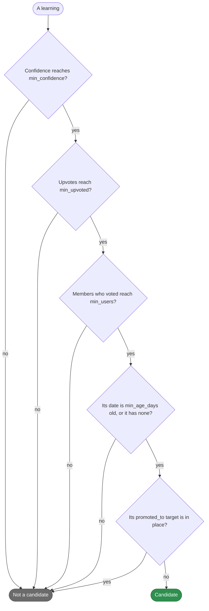
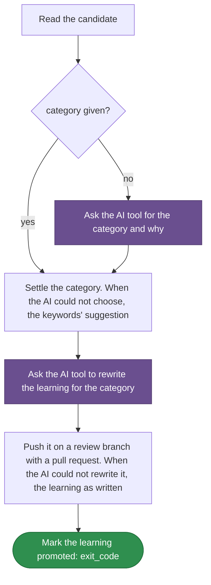

# teamai-promote-learning

English | [中文](README.zh-CN.md)

Promotes a team learning to a skill, rule or doc. The AI tool picks the category unless the person gave one, and rewrites the learning for it. teamai pushes the result on a review branch with a pull request that says the category and why, then marks the learning promoted.

| Started by | |
|---|---|
| `teamai recall promote <learning-id>` | `--category` gives the category |
| An agent session | `invoke: ask`, so an agent starts it once the person agrees |

## Which learnings it promotes



`teamai recall promote` lists the candidates, the `learning` and `publish` steps take only a candidate, and the dashboard's Promote tab shows them. All of them read the same `params.yaml`.

## How teamai's version runs



Purple marks a prompt the AI tool answers. An AI tool the member names that cannot run fails the run instead of falling back. `WORKFLOW.yaml` holds the steps.

## Files

| File | What it is |
|---|---|
| `WORKFLOW.yaml` | The steps, and the `output:` each step declares |
| `params.yaml` | Which learnings can be promoted |

## Inputs

| Input | Type | Meaning |
|---|---|---|
| `learning` | `string` | The learning's id, as `teamai recall promote` lists it |
| `category` | `string` | `skills`, `rules` or `docs`. `''` lets the AI tool pick |

## Outputs

| Output | Meaning |
|---|---|
| `exit_code` | `0` once the learning is marked promoted |

## Parameters

| Key | Range | What it sets |
|---|---|---|
| `min_confidence` | 0-1 | The confidence a learning needs, from its votes |
| `min_upvoted` | 1-1000 | The upvotes it needs, from every member together |
| `min_users` | 1-1000 | The members who must have voted on it |
| `min_age_days` | 0-3650 | How many days old its `date` must be. A learning with no `date` passes |

## Replace it

Put only the files you change in `workflows/teamai-promote-learning/` at the root of the team repo. Every other file, `WORKFLOW.yaml` included, stays teamai's and keeps getting teamai's updates. A small team that wants one other member's vote to be enough:

```yaml
# workflows/teamai-promote-learning/params.yaml
min_users: 1   # the other keys keep teamai's values
```

Push the folder. After the next `teamai pull`, the listing, the steps and the dashboard all use it. A key you leave out of `params.yaml` keeps teamai's value from its `params.yaml`.

A `WORKFLOW.yaml` of your own in the folder replaces the steps, and `params.yaml` still decides which learnings it takes. A `workflows/teamai-promote-learning.yaml` file replaces the folder whole, so teamai's parameters apply.

| Keep | Why |
|---|---|
| The inputs and outputs above | `teamai recall promote` passes those inputs and reads that output |

## What pull refuses

| A team folder that | Pull |
|---|---|
| Sets a value out of range, or a key the table above does not list | Names the file and the field. The version pull last took stays in force, teamai's until it took one |

`teamai review --branch` fails such a folder before you merge it.

## Requires

| Needs | Without it |
|---|---|
| An AI tool | The keywords' category and the learning as written are used. A tool the member names that cannot run fails the run |
| Push access to the team's knowledge | The learning stays a candidate, so a later run can promote it |

## Settings that change it

| Setting | Team `teamai.yaml` | Member config | Environment | Effect |
|---|---|---|---|---|
| AI tool | | `workflows.tools.default`, then `ai.tool` | `TEAMAI_AI_TOOL`, before both | Picks the tool that chooses the category and rewrites the learning |
| Driver | `workflows.driver` | `workflows.driver` | | Picks where the command starts the run. Unset means this machine |

The member config is `~/.teamai/projects/<slug>/config.yaml` in a workspace, then `~/.teamai/config.yaml`. The environment wins over the member config, and the member config wins over the team. See [member settings](https://github.com/Tencent/teamai-cli/blob/main/docs/guide/reference.md#member-settings) for the defaults.
