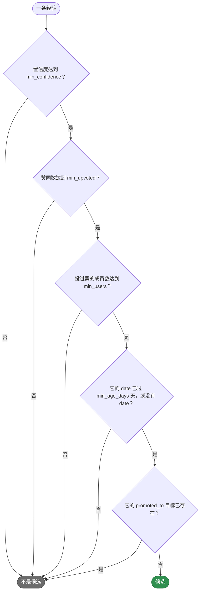
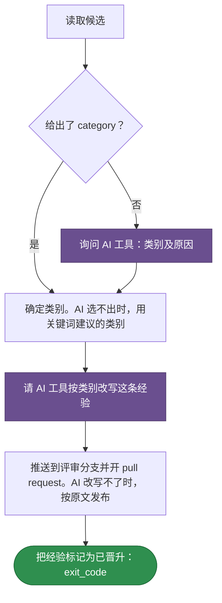

# teamai-promote-learning

[English](README.md) | 中文

把一条团队经验晋升为 skill、规则或文档。除非成员已经给出类别，否则由 AI 工具选出类别，并按该类别改写这条经验。teamai 把结果推送到一个评审分支，附带说明类别及原因的 pull request，然后把这条经验标记为已晋升。

| 启动方式 | |
|---|---|
| `teamai recall promote <learning-id>` | `--category` 指定类别 |
| agent 会话 | `invoke: ask`，所以 agent 在成员同意后才启动它 |

## 哪些经验可以晋升



`teamai recall promote` 列出候选，`learning` 和 `publish` 两个步骤只接受候选，dashboard 的 Promote 标签页展示它们。它们读的都是同一个 `params.yaml`。

## teamai 的版本如何运行



紫色表示由 AI 工具回答的提示词。成员指定的 AI 工具无法运行时，运行会失败，而不是退回其他做法。`WORKFLOW.yaml` 保存这些步骤。

## 文件

| 文件 | 是什么 |
|---|---|
| `WORKFLOW.yaml` | 步骤，以及每个步骤声明的 `output:` |
| `params.yaml` | 哪些经验可以晋升 |

## 输入

| 输入 | 类型 | 含义 |
|---|---|---|
| `learning` | `string` | 经验的 id，即 `teamai recall promote` 列出的那个 |
| `category` | `string` | `skills`、`rules` 或 `docs`。`''` 表示让 AI 工具选 |

## 输出

| 输出 | 含义 |
|---|---|
| `exit_code` | 经验被标记为已晋升后为 `0` |

## 参数

| 键 | 范围 | 设置什么 |
|---|---|---|
| `min_confidence` | 0-1 | 经验按投票算出的置信度至少要多少 |
| `min_upvoted` | 1-1000 | 所有成员加起来至少要多少个赞同 |
| `min_users` | 1-1000 | 至少要多少位成员投过票 |
| `min_age_days` | 0-3650 | 它的 `date` 至少要过去多少天。没有 `date` 的经验直接通过 |

## 替换它

在团队仓库根目录的 `workflows/teamai-promote-learning/` 里只放你要改的文件。其他文件（包括 `WORKFLOW.yaml`）仍用 teamai 的，并继续获得 teamai 的更新。小团队希望另一位成员投一票就够：

```yaml
# workflows/teamai-promote-learning/params.yaml
min_users: 1   # the other keys keep teamai's values
```

推送这个文件夹。下一次 `teamai pull` 之后，列表、步骤和 dashboard 都用它。`params.yaml` 里没写的键，沿用 teamai 的 `params.yaml` 里的值。

文件夹里放你自己的 `WORKFLOW.yaml` 会替换步骤，`params.yaml` 仍决定它接受哪些经验。`workflows/teamai-promote-learning.yaml` 单个文件会整体替换这个文件夹，此时用 teamai 的参数。

| 保留 | 原因 |
|---|---|
| 上面的输入和输出 | `teamai recall promote` 会传这些输入、读这个输出 |

## pull 拒绝什么

| 团队文件夹 | pull 的处理 |
|---|---|
| 设置了超出范围的值，或上表没有列出的键 | 指出文件和字段。pull 上一次接受的版本继续生效，还没接受过时用 teamai 的 |

`teamai review --branch` 会在合并前让这样的文件夹不通过。

## 依赖

| 需要 | 没有时 |
|---|---|
| AI 工具 | 用关键词建议的类别，并按原文发布。成员指定的工具无法运行时，运行失败 |
| 团队知识库的推送权限 | 经验仍是候选，之后的运行可以再晋升它 |

## 影响它的设置

| 设置 | 团队 `teamai.yaml` | 成员配置 | 环境变量 | 作用 |
|---|---|---|---|---|
| AI 工具 | | `workflows.tools.default`，其次是 `ai.tool` | `TEAMAI_AI_TOOL`，优先于两者 | 选出决定类别、改写经验的工具 |
| 驱动 | `workflows.driver` | `workflows.driver` | | 选出命令在哪里启动运行。未设置表示本机 |

成员配置在工作区里是 `~/.teamai/projects/<slug>/config.yaml`，其次是 `~/.teamai/config.yaml`。环境变量优先于成员配置，成员配置优先于团队。默认值见[成员设置](https://github.com/Tencent/teamai-cli/blob/main/docs/guide/zh-CN/reference.md#成员设置)。
